# Carbon Urban DSS 사용자 매뉴얼

| 항목 | 내용 |
|---|---|
| 문서 번호 | CUD-UM-001 |
| 판 | **2.0 (2026-10-22)** — 모든 화면·기능, 켜기·끄기 버튼, 안내 주소, 10/21 사용성 고침, 자료 범위 갱신. 1.0(2026-10-08)의 사례 절은 그대로 둠 |
| 대상 | 도시계획·개발사업 검토자, 에너지·탄소 담당자, 프로젝트 팀원 |
| 적용 버전 | Carbon Urban DSS 0.1.0 (GitHub `shy0401/Carbon-Urban-DSS` main, 2026-10-22) |
| 기준 자료 | 화면 그림: PC DB 2026-10-22. 5절 사례 값: 2026-10-08 자료 묶음(`carbon-dss-bundle-20261008-050941`)과 사례 파일 `backend/cases/simulation_cases.json` |
| 사용 영상 | 부록 E (약 14분, 나레이션·자막·배경음악) |
| 관련 문서 | [자료 범위와 완성도](DATA_COVERAGE.md) · [공통 데이터 기준](DATA_STANDARD.md) · [팀원 PC 재현](TEAM_SETUP.md) · [한계](LIMITATIONS.md) · [사용성 검토](UX_REVIEW_2026-10-13.md) |

> 이 매뉴얼의 숫자는 모두 이 도구가 실제 DB 위에서 계산한 값입니다. 계획 면적·목표 감축률 같은 **입력은 예시(가상)** 이고, 결과는 그 입력에 대한 1차 추정입니다. 인허가·설계 수치로 쓰지 않습니다.

## 목차

1. 제품 개요
2. 설치·켜기·끄기·접속
3. 자료 범위
4. 화면별 기능 (모든 메뉴)
5. 실습: 지역을 골라 시뮬레이션하기 (사례 25개)
6. 결과 읽는 법
7. 보고서
8. 자료를 더 모으기
9. 다른 PC에서 같은 결과 확인하기
10. 문제 해결
11. 한계와 주의
- 부록 A 계산식 · 부록 B 용어 · 부록 C 명령어 · 부록 D 사례 입력값 · 부록 E 사용 영상

---

## 1. 제품 개요

### 1.1 무엇을 하는 도구인가

Carbon Urban DSS는 **관측된 건물 에너지 사용량으로 도시의 운영 탄소를 계산**하고, 개발 계획이 그 탄소를 어떻게 바꾸는지 미리 보는 의사결정 지원 도구입니다.

| 할 수 있는 일 | 쓰는 메뉴 | 결과 |
|---|---|---|
| 전국 시·군·구의 인구·주택·전력·온실가스 개요 보기, 분석할 지역 준비 | 전국 지역, 지도 분석(1·2단계) | 시·도 → 시·군·구 → 읍면동, 지역 준비 단계 |
| 500m 격자로 전력·가스·탄소·원단위·밀도·용도지역 보기 | 지도 분석(3단계), 대시보드 | 격자 지도, 격자 상세, 동별 비교, 지표 카드 |
| 관측 범위·출처·모델 검증 확인 | 분석, 모델 | 난방도일·인구·용도지역 면적, 공간 교차검증, 공식 통계 맞대기 |
| 지역(행정동·반경·용도지역·격자)의 과거~현재 전력·탄소 | 지역 시뮬레이션 | 연도별 관측 전력, 개발 이력, 기상, 인구, 건물 전체 에너지 |
| 과거 개발이 지역 전력을 얼마나 바꿨는지 | 지역 시뮬레이션 → 개발 전후 영향 | 개발 연도 앞뒤 평균 비교, 추정 증가량 |
| 앞으로 개발하면서 목표 감축률을 지키려면 무엇이 필요한지 | 지역 시뮬레이션 → 미래 개발과 감축 노력·감축 수단 조합 | 필요 감축량(t), 효율 개선률(%), 재생에너지 kWh, 태양광 kW, 수단 조합 |
| 대지에 건물 배치안을 놓고 3D로 보기, 연간 탄소 추정 | 시뮬레이션 | 3D 배치·일조, 용적률·건폐율, 월별 전력·가스·탄소, 기준안 대비 절감 |
| 계획안이 용도지역·조례 상한 안인지 1차 확인, 상한 안 최적안 | 시뮬레이션 | 용도지역 비율, 조례 상한, 이내/초과, 최적안 3개 |
| 근거가 고정된 보고서 | 검토 보고서, 지역 시뮬레이션 → 보고서 | 화면·마크다운·인쇄(PDF) 보고서, 근거 SHA-256 |
| 빠진 자료 한 번에 수집, 출처별 상태 확인 | 수집 데이터 | 연도·자료별 빈칸 표, 자동 재개, 파일 올리기 |

### 1.2 하지 않는 것

- **인허가 판단을 하지 않습니다.** 용도지역·조례 상한은 1차 확인이며 지구단위계획·완화 규정이 우선합니다.
- **넷제로 달성을 판정하지 않습니다.** 감축 노력은 전력 운영 탄소 기준의 역산입니다(가스는 가정 계수로 따로 표시).
- **빈 값을 0으로 채우지 않습니다.** 관측이 없으면 빗금과 "자료 없음"으로 보여 줍니다.
- **숫자를 AI가 만들지 않습니다.** 보고서의 숫자는 계산 엔진의 근거 문장에서만 나옵니다(7절).

### 1.3 화면 구성

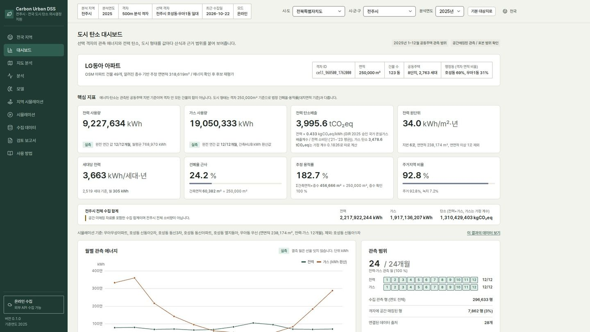

| 위치 | 하는 일 |
|---|---|
| 왼쪽 메뉴 | 화면 10개: 전국 지역 · 대시보드 · 지도 분석 · 분석 · 모델 · 지역 시뮬레이션 · 시뮬레이션 · 수집 데이터 · 검토 보고서 · 사용 방법 |
| 왼쪽 아래 모드 단추 | **온라인 수집**(외부 API 수집 가능) ↔ **오프라인 데모**(검증된 로컬 스냅샷만 씀). 누르면 바뀝니다. 아래에 버전·기준연도 |
| 위쪽 표제란 | 분석 지역 · 분석연도 · 격자(500m) · 선택 격자(지명) · 최근 수집일 · 모드. 어느 화면에서나 지금 범위를 보여 줌 |
| 오른쪽 위 분석 범위 | **시·도 → 시·군·구 → 분석연도**. 고르면 모든 화면이 함께 바뀜. **기본 대상지로**는 그 지역의 기본 격자(공동주택 세대가 가장 많은 격자)로 돌아감. **전국**은 전국 지도로 |
| 머리 아래 알림 | 처음 고른 시·군·구의 기본 지도를 만드는 중 · 기본 지도만 있는 지역 안내 · **링크가 분석 지역을 바꿨을 때 알림과 되돌리기** |
| 키보드 | Tab을 처음 누르면 **본문으로 건너뛰기**가 나옵니다 |

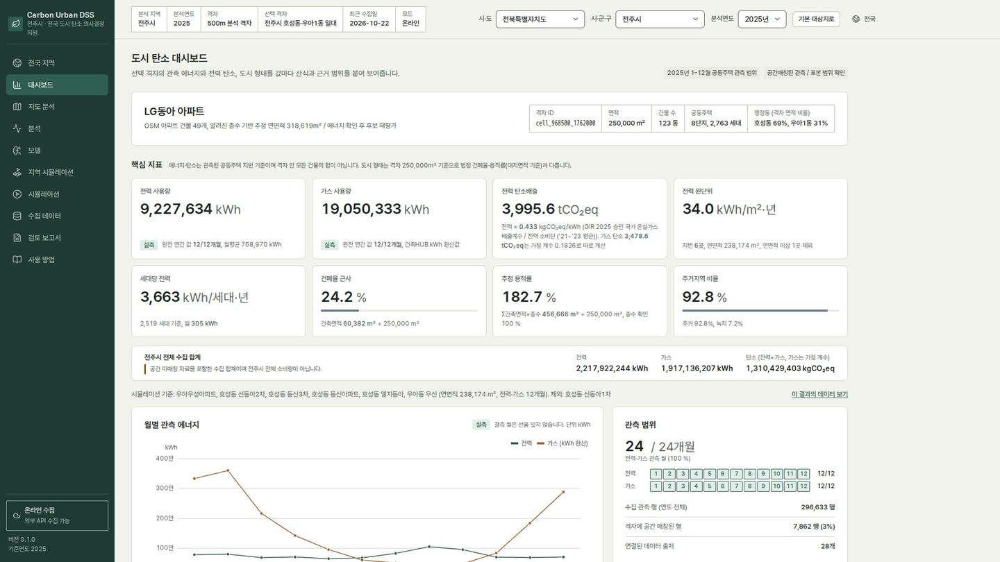

- **분석연도**: 자료가 있는 마지막 해(서버 기준연도, 지금 2025)부터 2015년까지 고릅니다. 예전 주소로 그 뒤 해가 들어오면 "(자료 없음)"이 붙습니다.
- **선택 격자**: 지도에서 격자를 누르면 모든 분석 화면(대시보드·분석·시뮬레이션·보고서)의 대상지가 그 격자로 바뀝니다.
- 없는 주소로 들어가면 "없는 화면입니다"와 갈 수 있는 화면 목록이 나옵니다.

### 1.4 값의 종류 (배지)

| 배지 | 뜻 | 예 |
|---|---|---|
| 실측(관측) | 공공기관이 측정·공표한 값 | 건축HUB 지번 전력, K-apt 단지 전력 |
| 계산 | 관측값에 공식 계수·면적을 곱한 값 | 전력 탄소 = kWh × 0.4330 |
| 추정 | 가정이 들어간 근사값(점선·"추정값") | 연면적 × 지역 원단위, 태양광 발전량 |
| 시나리오 | 계획 입력에 따른 결과 | 계획안 연간 탄소 |
| 대체 | 공식 자료가 없어 다른 출처를 쓴 값 | ERA5 일사량(전주 밖 지역) |
| 자료 없음 | 계산하지 않음(빗금, "—") | 2019년 이전 건축HUB |
| 일부 단지 · 비교 주의 | 관측 단지가 적은 해(빗금·흐린 막대), 관측 범위가 달라 비교하기 어려운 값(흐린 숫자) | 지역 시뮬의 2017년 전력, 개발 전후 지역 합계 변화 |

### 1.5 이 PC에서만 보이는 기능

다음 세 기능은 자료의 이용 조건 때문에 **자료를 가진 PC 화면에서만** 보이고, 공개 시연 주소와 이 문서·영상의 그림에는 넣지 않았습니다.

| 기능 | 어디서 | 하는 일 |
|---|---|---|
| 100m 격자 (국토통계지도, 국외 반출 금지) | 지도 분석 → 레이어, 격자 상세 | 확대 13 이상에서 100m 칸을 인구·건물 수·추정 연면적·평균 사용승인연도로 칠함. 격자 상세에 5×5 = 25칸 |
| 100m 전기 배출 (선도소프트 탄소공간지도) | 지도 분석 → 레이어, 격자 상세, 지역 시뮬레이션 | 전주 2023·2024 건물 전기 배출(tCO₂eq). 지역 시뮬의 기준 건물 "건물 전체 (탄소공간지도 100m)" |
| 개발 변화 예측 (팀 변화 모델 7차) | 지도 분석 → 격자 상세 | 팀 데이터셋 53개 지역 500m 칸에 신축·철거 연면적을 넣으면 건물 배출 변화(tCO₂e/년)와 80% 구간 |

자세한 규칙: [선도소프트 100m](SUNDOSOFT_KCSM100.md), [팀 데이터셋](TEAM_DATASET.md) 7절.

---

## 2. 설치·켜기·끄기·접속

### 2.1 요구 사양

| 항목 | 요구 |
|---|---|
| 운영체제 | Windows 10/11 (WSL2) |
| 프로그램 | Docker Desktop(Linux 엔진), Git for Windows |
| 메모리 | 16GB 이상 권장 (Docker에 8GB 이상, 팀 변화 모델을 켜면 +1GB) |
| 디스크 | 여유 25GB 이상. Docker 디스크 이미지는 C가 아닌 드라이브에 두어도 됨 |
| 브라우저 | Chrome·Edge 최신판 (3D는 WebGL 사용) |
| 네트워크 | 자료를 새로 받을 때와 공개 시연 주소에만 필요. 자료 묶음으로 시작하면 오프라인으로도 화면·계산 가능 |

### 2.2 설치 (처음 한 번)

```powershell
git clone https://github.com/shy0401/Carbon-Urban-DSS.git
cd Carbon-Urban-DSS
if (-not (Test-Path .env)) { Copy-Item .env.example .env }   # API 키는 비워 둬도 됨(자료 묶음으로 시작할 때)
scripts\dss.cmd Doctor                                       # Docker·포트·디스크·.env 형식 점검(키 값은 출력하지 않음)
```

### 2.3 자료 묶음 가져오기 (권장)

자료를 가진 PC가 만든 묶음(`carbon-dss-bundle-<시각>.zip`)을 받아 **빈 DB**에 넣습니다.

```powershell
scripts\dss.cmd ImportBundle -BundlePath D:\share\carbon-dss-bundle-20261008-xxxxxx.zip
```

실행기는 다음 순서로 진행합니다.

1. SHA-256 확인
2. DB 복원
3. 전 테이블 행 수 비교
4. 수집 완료 표시 복원(`collection-progress.json` → `data/ops/history-progress.json`)
5. 서비스 기동·화면 확인
6. **묶음에 들어 있는 사례 25개를 이 PC에서 다시 계산해 기준 PC 값과 비교**(9절)

마지막 줄에 `simulation cases: 25/25 match`가 나오면 이 PC의 계산 결과가 기준 PC와 같습니다. 이미 자료가 있는 PC에 팀원 자료를 **더할 때**는 `MergeBundle`을 씁니다([팀원 PC 재현](TEAM_SETUP.md) 2.1-1).

### 2.4 켜기·끄기 (바탕화면 버튼)

자료를 가진 PC에는 바탕화면에 버튼 두 개가 있습니다(`scripts\install-power-buttons.ps1`로 만듦, 내용은 `scripts\dss-power.ps1`).

| 버튼 | 하는 일 | 걸리는 시간 |
|---|---|---|
| **[Carbon DSS 켜기]** | ① 자동 켜기(지킴이) 다시 켬 ② Docker Desktop 켜기 ③ DB·API·화면·공개 연결(+ 로컬 AI·팀 변화 모델이 있으면 함께) 올리기 ④ 새 시연 주소를 안내 주소에 올리기 | 2~4분 (팀 변화 모델은 그 뒤 약 4분 학습) |
| **[Carbon DSS 끄기]** | ① 자동 켜기를 쉬게 함(`data\deployment\demo-watch.paused`) ② 서비스를 차례로 멈춤(DB 안전 종료) ③ Docker Desktop 끄기 | 1~2분 |

- 켜기 뒤 이 PC에서는 `http://localhost:5173`으로 접속합니다.
- **자료를 수집하는 동안에는 끄지 않습니다**(8절). 끄면 수집 작업도 멈추고, 다음에 켜면 이어서 받습니다.
- 끈 뒤에는 재부팅해도 스스로 켜지지 않습니다. 다만 Docker Desktop 설정의 "Start when you sign in"이 켜져 있으면 로그온 때 Docker Desktop만 켜질 수 있습니다(서비스는 지킴이가 쉬는 동안 올라오지 않음).
- 명령으로도 됩니다: `powershell -File scripts\dss-power.ps1 -Mode On|Off|Status`.

### 2.5 밖에서 보기 (안내 주소)

- 공개 시연은 **https://shy0401.github.io/Carbon-Urban-DSS/** 하나만 알리면 됩니다.
- 이 페이지는 PC의 시연 서버(그때그때 바뀌는 터널 주소)가 살아 있는지 확인한 뒤 같은 경로로 넘겨 줍니다. 시연 계정으로 로그인해야 합니다.
- 작업 스케줄러의 **지킴이**(`\CarbonDSS demo address watch`, 로그온 1분 뒤와 5분마다)가 터널 주소가 바뀌면 안내 주소를 고칩니다. 끄기 버튼으로 쉬게 한 동안은 아무것도 하지 않습니다.
- 공개 주소에서는 1.5절의 PC 전용 기능과 자료 수집이 빠집니다.
- PC가 꺼져 있거나 절전·로그온 전이면 안내 주소에 "연결되지 않습니다"가 나옵니다.

### 2.6 명령으로 실행·중지

| 하는 일 | 방법 |
|---|---|
| 켜기 | 바탕화면 버튼, 또는 `docker compose -p carbon-urban-dss -f compose.yaml -f compose.demo.yaml up -d` |
| 접속 | 브라우저 `http://localhost:5173` |
| 끄기(자료 유지) | 바탕화면 버튼, 또는 `docker compose -p carbon-urban-dss -f compose.yaml -f compose.demo.yaml stop` |
| 새 코드 반영 | `git pull` → `scripts\dss.cmd Rebuild` |

> ⚠ `docker compose down -v`는 수집한 DB를 지웁니다. 쓰지 않습니다.

---

## 3. 자료 범위 (2026-10-22 기준)

전체 표와 출처별 빈 곳의 이유는 **[자료 범위와 완성도](DATA_COVERAGE.md)** 에 있습니다. 요약은 다음과 같습니다.

| 지역 (코드) | 건축HUB 지번 에너지 | K-apt 단지 에너지 | 건축물대장·용도지역·건물·지적 | 기상·일사량 |
|---|---|---|---|---|
| 전주시 (52110) · 기본 지역 | 2020~2025 | **2015~2025** | 있음 | KMA ASOS 146 관측 |
| 군산시 (52130) · 완주군 (52710) | 2020~2025 | 2021~2025 (2015~2020 수집 중) | 있음 | ERA5 대체 |
| 수원시 (41110) · 가평군 (41820) | 2020~2025 | 2021~2025 (2015~2020 수집 중) | 있음 | ERA5 대체 |
| 세종시 (36110) · 서울 강동구 (11740) · 부산 강서구 (26440) | 2020~2025 | 2021~2025 (2015~2020 수집 중) | 있음 | ERA5 대체 |
| 전북 남은 시·군 11곳 (익산부터) | 준비 중 | 준비 중 | 준비 중 | — |
| 전국 시·군·구 | — | 단지 목록 22,555곳 | — | — |

- 건축HUB는 **2020-01 사용분부터** 제공합니다(2019년 이전 미공표). 단독주택·200세대 미만 공동주택은 제공 범위 밖입니다.
- K-apt는 단지가 관리비를 보고하지 않은 달이 있습니다(2025년 행의 5~19%). 받을 수 없는 값이라 "자료 없음"입니다.
- 2026-10-22부터 운영계정 한도에 맞춰 남은 연도·지역을 PC에서 이어 받고 있습니다(8절, [자료 범위 6절](DATA_COVERAGE.md#6-대량-수집-2026-10-22-시작)).

### 3.1 계수

| 항목 | 값 | 비고 |
|---|---|---|
| 2025년 전력 배출계수 | 0.4330 kgCO2eq/kWh | GIR 2025 승인 '21~'23 평균 |
| 2022~2024 | 0.4781 | 2021 승인 |
| 2019~2021 | 0.4594 | 2018 승인 |
| 도시가스 | 0.1826 kgCO2eq/kWh | **가정** 계수(공식 계수 확정 전) |
| 태양광 성능비 | 0.80 | 수평면 일사량 × 0.80 (경사 보정 없음) |

---

## 4. 화면별 기능

### 4.1 전국 지역

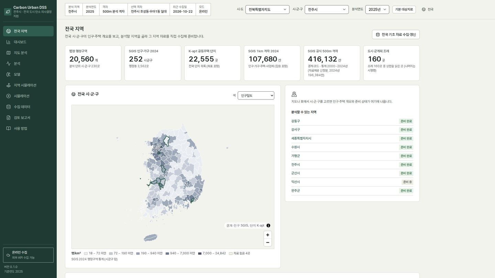

| 부분 | 내용 |
|---|---|
| 위쪽 카드 | 전국 공통 자료의 범위: 법정 행정구역, SGIS 인구·가구, K-apt 단지, SGIS 1km·공식 500m 격자, 도시계획 조례 |
| 전국 시·군·구 지도 | 색 기준(인구밀도·가구·공동주택 단지 수 등)을 바꿔 칠함. 상세 자료 지역은 굵은 테두리 |
| 분석할 수 있는 지역 | 준비한 지역과 상태(준비 완료·준비 중·일부) |
| 시·군·구 표 | 전국 시·군·구 검색·정렬 |
| **전국 기초 자료 수집·갱신** | 행정구역·SGIS·K-apt 단지 목록·500m 격자·조례를 다시 받음(자료를 가진 PC) |

지역을 누르면 인구·주택 요약과 **준비 단계**가 나옵니다.

- 준비 단계: 격자 → 행정동 → 기상·조례 → 단지 → 용도지역·건물·지적 → 건축물대장 → 건축HUB → K-apt
- 아직 준비하지 않은 시·군·구는 **상세 자료 수집**을 누릅니다.
- 처음 고르기만 해도 전국 공통 자료로 **기본 지도**를 몇 초 안에 만듭니다(에너지·건물·용도지역 값은 비어 있으며 0이 아님).

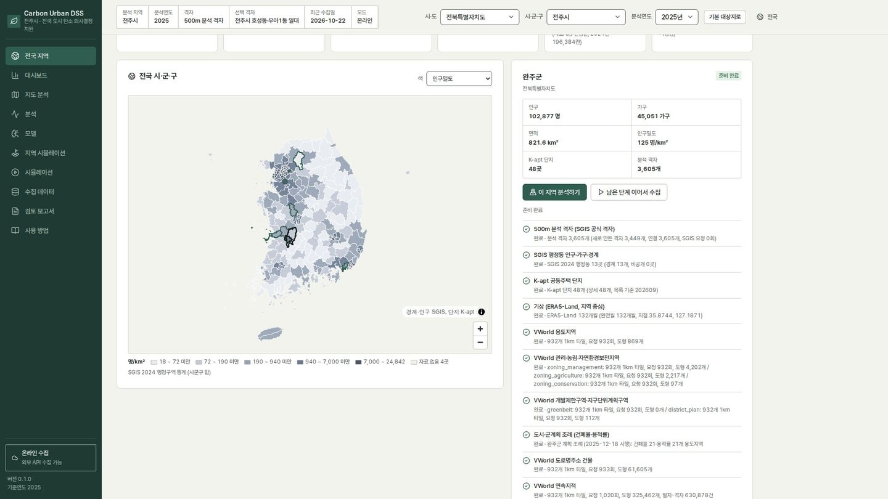

### 4.2 지도 분석

지도는 세 단계입니다. 메뉴로 들어가면 **마지막으로 본 보기**(처음에는 머리에서 고른 시·군·구 지도)로 열리고, 위의 단계 링크로 옮깁니다.

| 단계 | 하는 일 |
|---|---|
| 1. 전국 · 시·도 선택 | 시·도를 지도나 왼쪽 목록에서 골라 시·도끼리 비교(인구·밀도·가구·인구 증감·주택·종사자·공동주택 단지·한전 전력·지역 온실가스). 시·도를 고르면 그 시·군·구가 칠해지고, 시·군·구를 누르면 요약을 본 뒤 그 지도로 들어감 |
| 2. 시·도 500m 격자 | 시·도 전체를 SGIS 공식 500m 격자로 나눠 전국 공통 지표(인구·주택·공동주택)로 칠함(제주 제외). 격자를 누르면 그 시·군·구 지도로 |
| 3. 시·군·구 · 읍면동 | 분석 격자(500m, 250,000m²)와 읍면동. 지표·레이어·격자 상세·동별 비교 |

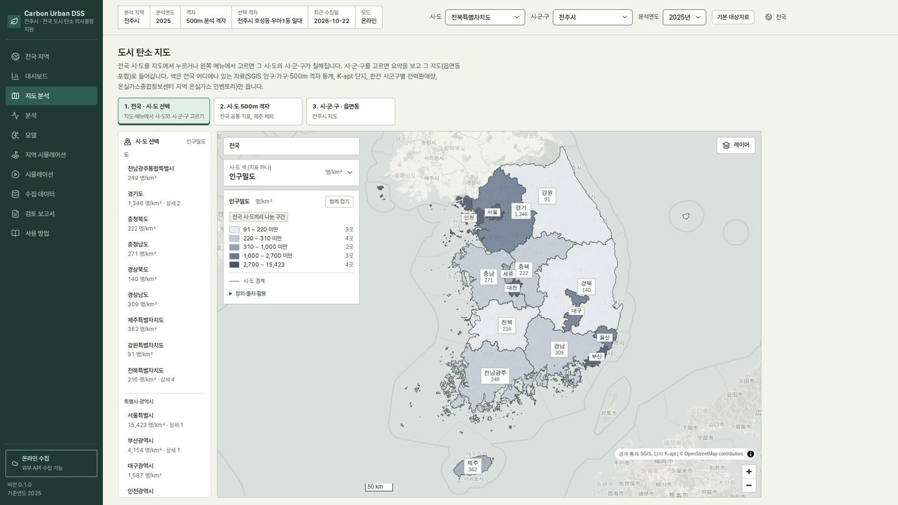

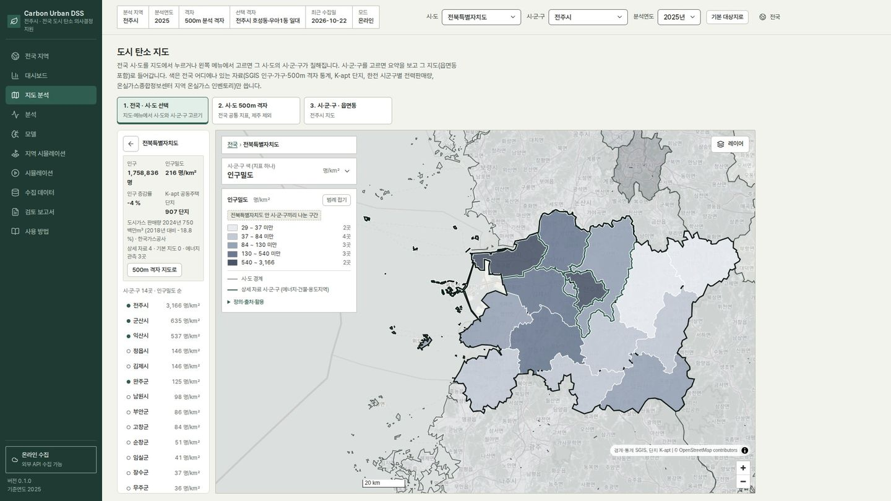

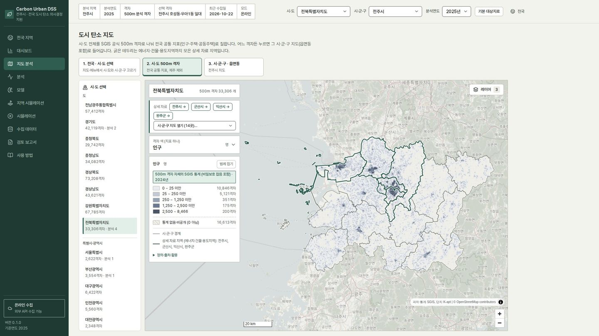

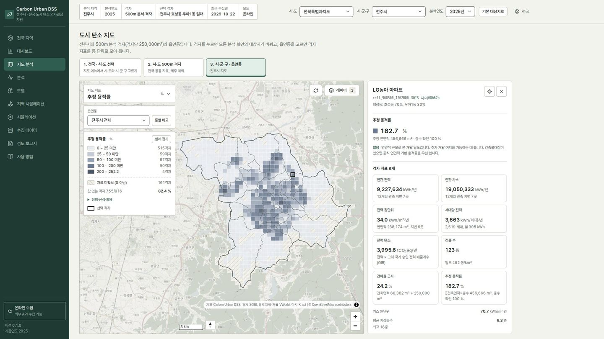

**지도 지표** (왼쪽 위에서 고름, 한 번에 하나)

| 묶음 | 지표 |
|---|---|
| 에너지 관측 · 원단위 · 탄소 | 연간 전력·가스 사용량, 전력·가스 원단위, 세대당 전력, 전력 탄소, 가스 탄소(가정 계수), 전력 탄소 원단위 |
| 건물 전체 에너지 (건축HUB) | 건물 전체 연간 전력·가스, 전력 원단위, 전력 탄소, 가스 탄소 |
| 탄소공간지도 (팀 수집) | 건물 배출 합계, 전기·가스·지역난방 배출, 증감률, 원단위 |
| 도시 형태 · 건축물대장 | 건물 수, 건폐율 근사, 추정 용적률, 평균 지상층수, 공동주택 세대·단지 수, 대장 용적률·연면적, 주거 연면적 비율, 2000년 이전 준공 비율 |
| 토지이용 | 주거지역 비율, 주거용 건물 비중 |
| SGIS 500m · 1km | 인구·가구·주택·종사자, 인구 증감률, 밀도, 65세 이상·1인가구·노후 주택·아파트 비율 |
| 데이터 품질 | 에너지 관측 완전성 |

범례에는 구간별 격자 수와 **자료 미확보(0 아님)** 격자가 따로 나오고, "정의·산식·활용"을 펼치면 지표 설명이 있습니다.

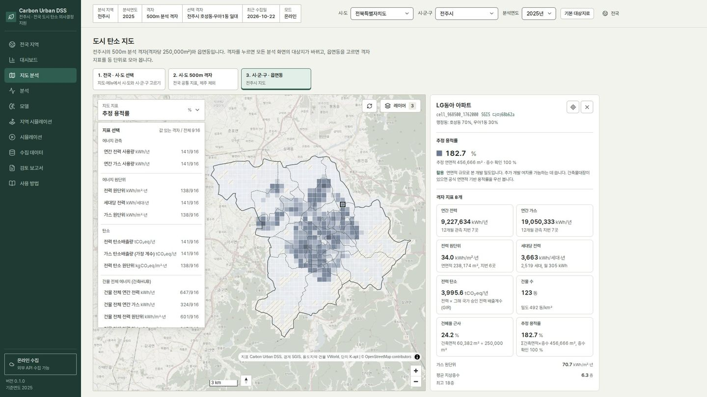

**레이어** (오른쪽 위): 분석 격자, 시·군·구·읍면동 경계, 겹쳐 보기(건물·공동주택 단지·용도지역·행정동 인구, 한 번에 하나), 배경지도. 건물은 확대 14 이상에서 화면 안 건물만 그립니다.

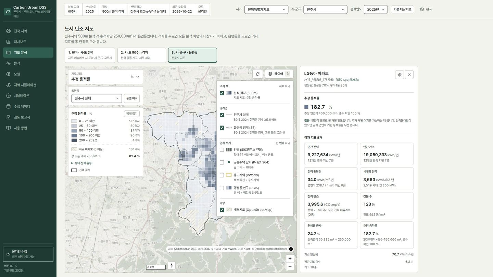

**격자 상세**: 격자를 누르면 오른쪽에 열립니다.

- 위쪽: 지금 지표의 값과 활용법, **격자 지표 8개**(연간 전력·가스, 전력 원단위, 세대당 전력, 전력 탄소, 건물 수, 건폐율, 추정 용적률)와 근거
- 아래쪽: 월별 관측, 용도지역과 건물 용도(건축물대장 연면적 기준), 건물 전체 에너지, 공동주택, SGIS 500m·1km 인구·주택
- 이 격자가 모든 분석 화면의 대상지가 됩니다.

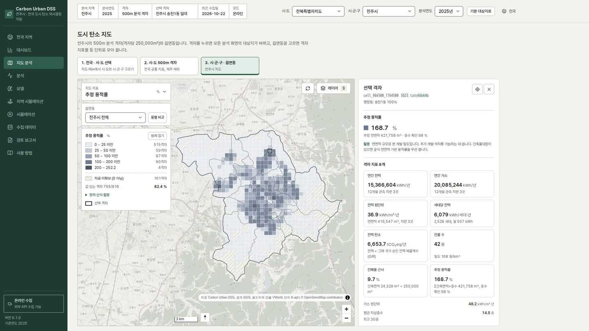

**읍면동**: 위쪽 선택 상자에서 동을 고르면 그 동의 공식 인구·가구와 격자 지표 모음이 나옵니다. **동별 비교**는 지금 지표로 동끼리 순위를 봅니다.

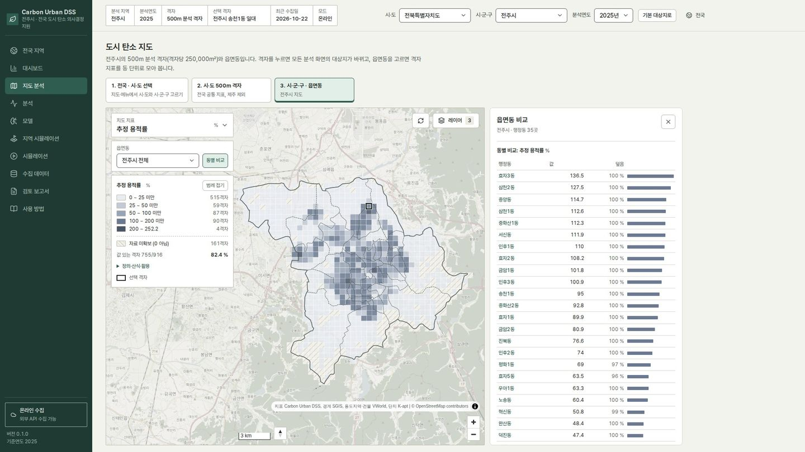

### 4.3 대시보드

선택 격자의 **핵심 지표 8개**를 카드로 보여 줍니다: 전력·가스 사용량, 전력 탄소, 전력 원단위, 세대당 전력, 건폐율 근사, 추정 용적률, 주거지역 비율.

- 카드 아래에는 산식과 근거 범위가 붙습니다. 예: 몇 개 지번, 몇 개월 관측, 어떤 계수인지.
- 맨 위에는 대상지 이름·선정 이유, 격자 ID·면적·건물 수·공동주택·행정동이 있습니다.
- 아래로 내리면 다음이 이어집니다.
  - 지역 전체 수집 합계
  - 월별 관측 에너지와 관측 범위(달별 칸)
  - 건물 용도 구성(건축물대장 연면적 기준)
  - 법정 용도지역
  - 건물 전체 에너지(건축HUB)
  - 인구·주택(SGIS)
  - 기상

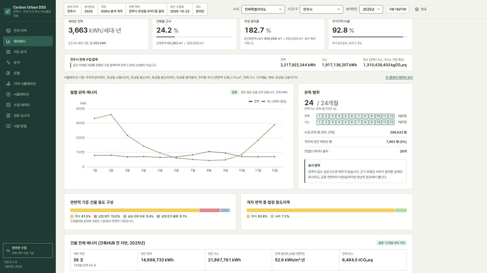

### 4.4 분석

해석의 범위를 판단하는 화면입니다.

- 선택 격자의 전력 탄소와 원단위
- 난방도일과 월별 에너지(같은 달의 에너지와 기상이 모두 있어야 표시)
- 행정동 인구(SGIS)
- 분석 격자 안 용도지역 면적(VWorld)
- 포함된 자료 출처 표

출처 표의 **마지막 수집 기간**은 분석연도와 관계없이 그 자료를 가장 최근에 받은 실행의 기간입니다.

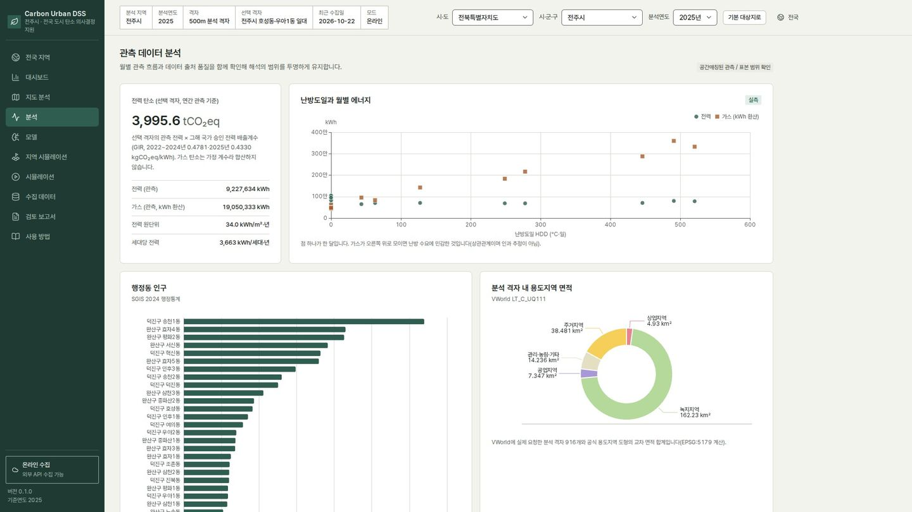

### 4.5 모델

전력·가스 원단위 모델의 **공간 블록 교차검증**(2km 블록) 결과입니다.

- 관측 수·격자·공간 블록·관측 월이 기준(120건·10격자·3블록·10개월)보다 적으면 성능을 만들지 않고 "학습 자료 부족"으로 표시합니다.
- **현재 자료로 검증**을 누르면 지금 DB로 다시 계산합니다.
- 아래 **공식 통계와 맞대기**에서는 건축HUB 합계를 한전 시군구 건물 전력과 연도별로 비교합니다(덮음·월별 상관·달마다 비율). 어느 쪽도 정답으로 보지 않고 차이와 포함 범위를 함께 봅니다.

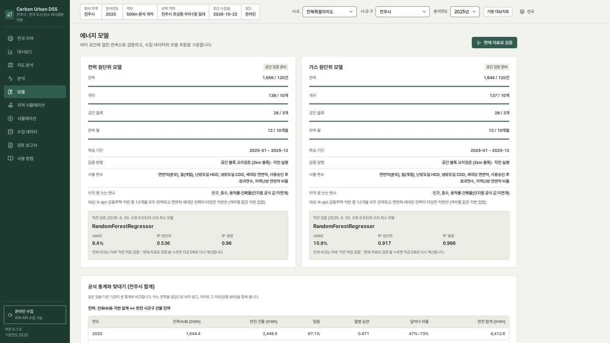

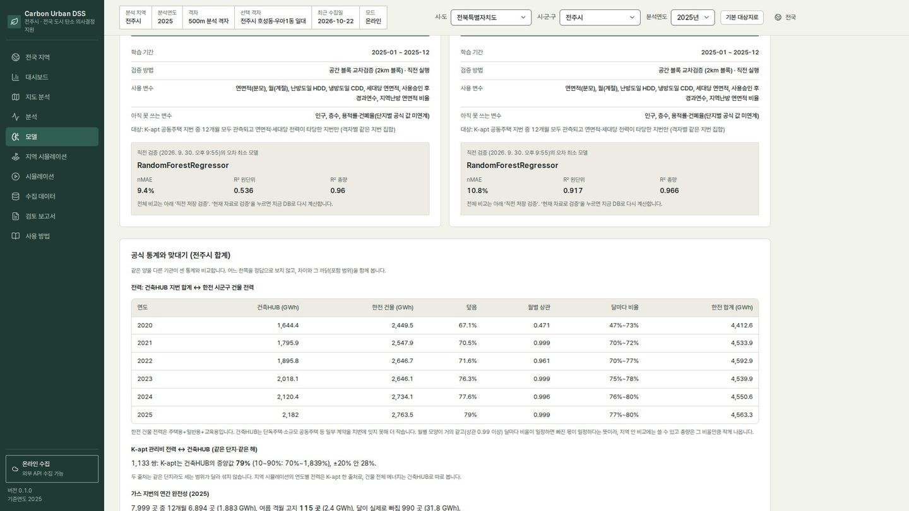

### 4.6 지역 시뮬레이션

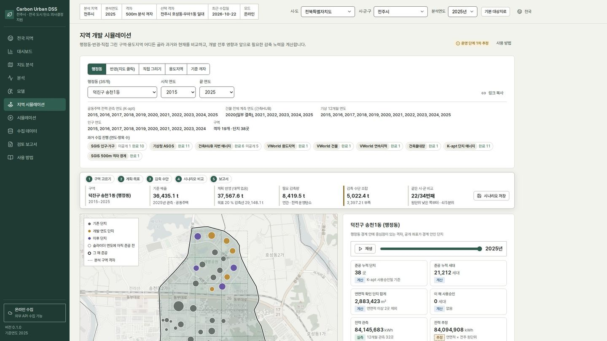

**구역을 고르는 5가지 방법**

| 방법 | 쓰는 때 | 링크 표기 |
|---|---|---|
| 행정동 | 동 단위 정책·통계와 맞출 때 | `area=admin:35012650` |
| 반경(지도 클릭) | 개발 예정지 주변 영향 | `area=circle:경도,위도,반경m` |
| 직접 그리기 | 사업 경계를 그대로 | (링크 불가) |
| 용도지역 | 상업지역 전체 등 용도별 비교 | `area=zone:COMMERCIAL` |
| 기준 격자 | 500m 격자 하나 | `area=grid:cell_966500_1764500` |

구역을 고르면 아래에 그 구역에 **어떤 연도의 자료가 출처별로 있는지**(K-apt·건축HUB·기상·인구)와 과거 수집 진행이 나옵니다. 처음 읽는 지역·기간은 1~3분 걸릴 수 있고, 8초가 지나면 경과 시간과 안내가 나옵니다.

**결과 요약 막대**: 화면을 내려도 머리 바로 아래에 붙어 있습니다.

- 단계 이동: ①구역 ②계획·목표 ③감축 수단 ④시나리오 비교 ⑤보고서
- 기준 배출, 계획 반영 배출, 필요 감축량, 감축 수단 조합 결과, 같은 시·군 행정동 비교 순위
- **시나리오 저장** 단추


**과거와 현재**

- **구역 지도**: 공동주택 단지를 개발 연도 기준으로 색을 나눕니다(기존·개발 연도·이후·아직 준공 전). 연도 슬라이더와 **재생**으로 해마다 단지가 들어서는 모습을 봅니다. 오른쪽에는 그해 누적 단지·세대·연면적과 전력 관측·추정이 나옵니다.
- **연도별 전력 사용량**: K-apt 관측 막대(단지 준공 시기별)와 추정선을 함께 그립니다.
  - 관측이 없는 해는 빗금 "관측 없음"으로 그립니다.
  - **관측 단지가 적은 해**(가장 잘 관측된 해의 절반 미만)는 빗금 "일부 단지"와 흐린 막대로 그려, 사용량이 준 것처럼 읽히지 않게 합니다.
- **개발 이력**(사용승인 세대), **기상**(난방·냉방도일), **인구·가구**(행정동), 모든 건물의 개발 이력(건축물대장).
- **건물 전체 에너지**(건축HUB): 상가·업무를 포함한 계측 지번 전체와 원단위, 같은 지번끼리 비교한 변화.
- **지역 특성**(SGIS 1km): 구역이 걸친 1km 격자의 인구·가구·주택·종사자.

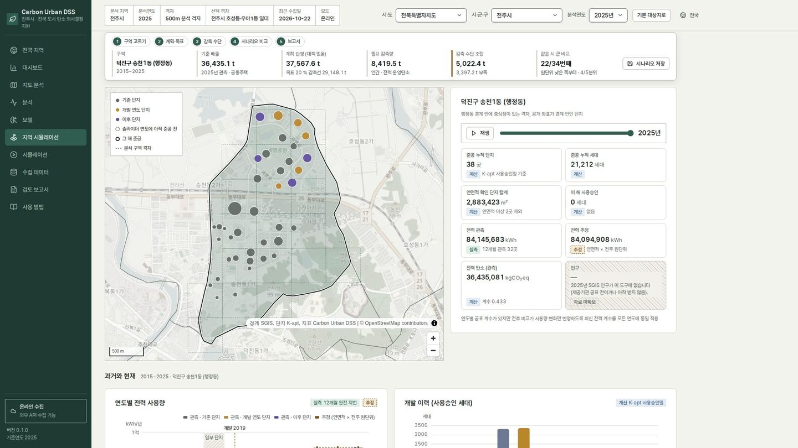

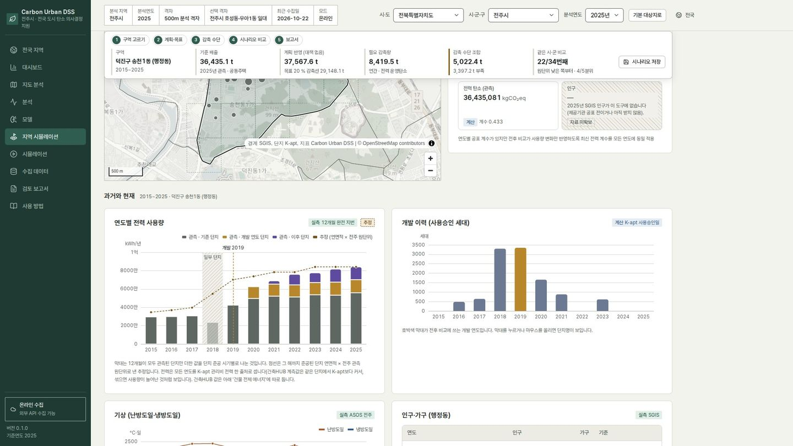

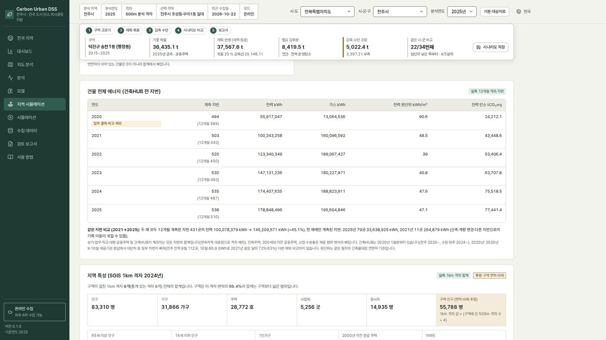

**개발 전후 영향**: 개발 연도(자동: 세대 증가가 가장 큰 해)와 비교 기간(앞뒤 1~5년)을 고르면 앞뒤 평균을 비교합니다. 개발 전 관측 단지가 개발 후 기존 단지보다 적으면 "관측 범위 주의"가 붙고, 지역 합계 변화는 흐리게 **비교 주의**로 표시합니다. 이때는 같은 단지끼리 비교한 "기존 단지만의 변화"를 봅니다.

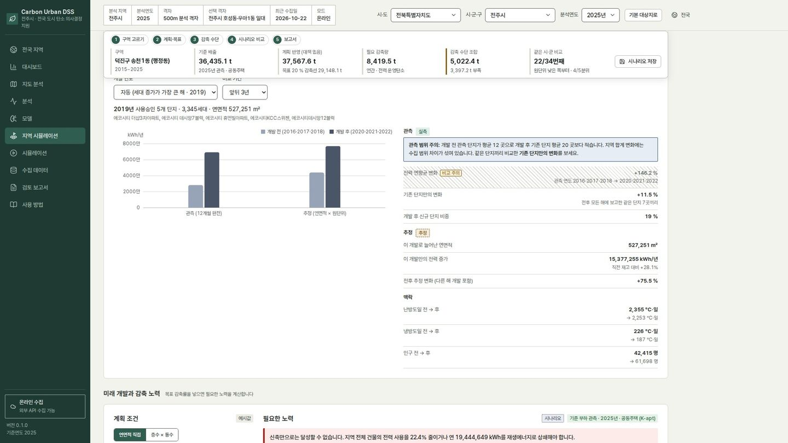

**미래 개발과 감축 노력**: 입력에 따라 다음을 계산합니다. **필요 감축량**, **신축만 효율화하면 필요한 개선률**, **지역 전체 효율 개선률**, **재생에너지 상쇄량**, **태양광 설비 용량**.

| 입력 | 뜻 | 예 |
|---|---|---|
| 시작·끝 연도 | 과거 비교 기간 | 2015~2025 |
| 추가·철거 연면적 | 앞으로 지을(헐) 연면적. "층수 × 동수 × 건축면적"으로도 입력 | 90,000 m² |
| 목표 감축률 | 기준 연도 대비 몇 % 줄일지 (슬라이더·숫자) | 20% |
| 기준 건물 | **공동주택(K-apt)**: 주거지 / **건물 전체(건축HUB)**: 상가·업무가 많은 곳 / **건물 전체(탄소공간지도 100m)**: 이 PC의 전주(1.5절) | 상업지는 건물 전체 |
| 태양광 kW당 연 발전량 | 비우면 지역 일사량 × 0.80 추정 | 비움 또는 1,200 |

- 고른 기준에 근거가 없으면 다른 기준으로 계산하고 맨 위에 파란 안내로 알립니다(예: 공동주택 단지가 없는 읍면).
- 철거 연면적이 기준 건물 규모보다 크면 계산하지 않고 고치라고 알립니다.

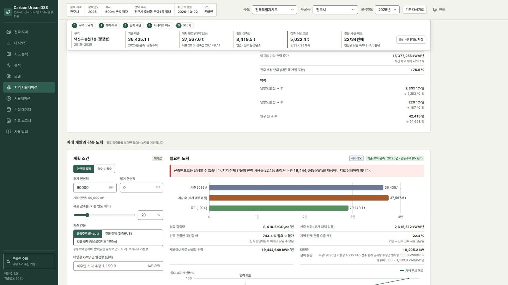

**같은 시·군 행정동 비교**: 같은 연도·같은 기준의 행정동 관측 원단위(kWh/m²·년) 분포에서 이 구역이 낮은 쪽부터 몇 번째인지(5분위) 보여 줍니다. 등급이 아니라 위치입니다.

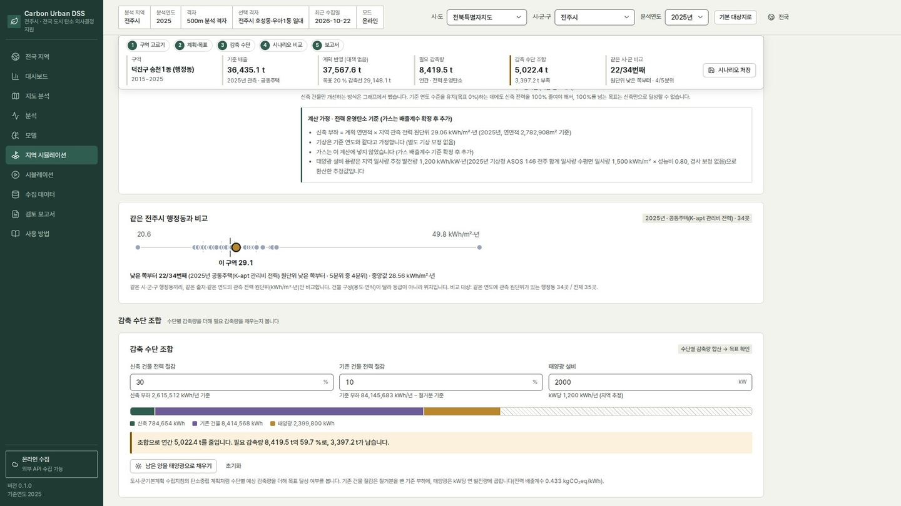

**감축 수단 조합** (③): 수단 셋을 함께 넣어 수단별 감축량 합계가 필요 감축량을 채우는지 봅니다.

- 입력: 신축 건물 전력 절감 %, 기존 건물 전력 절감 %, 태양광 kW
- **남은 양을 태양광으로 채우기** 단추가 있습니다.
- 링크에는 `mx=신축%,기존%,태양광kW`로 담깁니다.

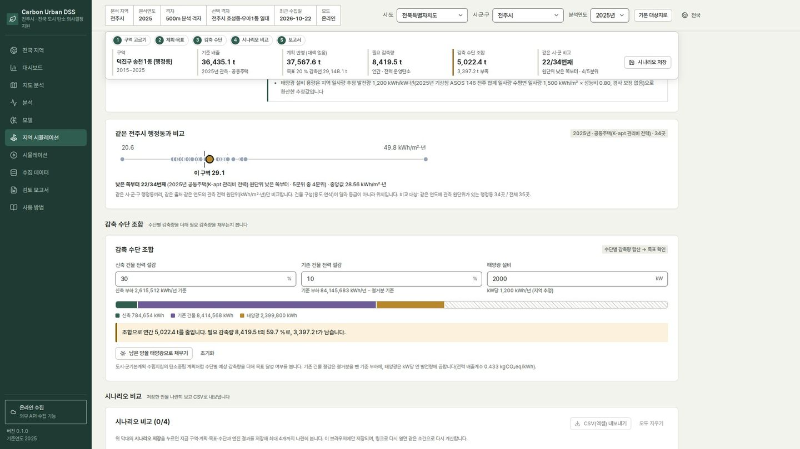

**시나리오 비교** (④): **시나리오 저장**한 안을 최대 4개까지 나란히 봅니다.

- **CSV(엑셀) 내보내기**와 링크 아이콘(같은 조건으로 다시 열기)을 씁니다.
- 이 브라우저에만 저장됩니다.

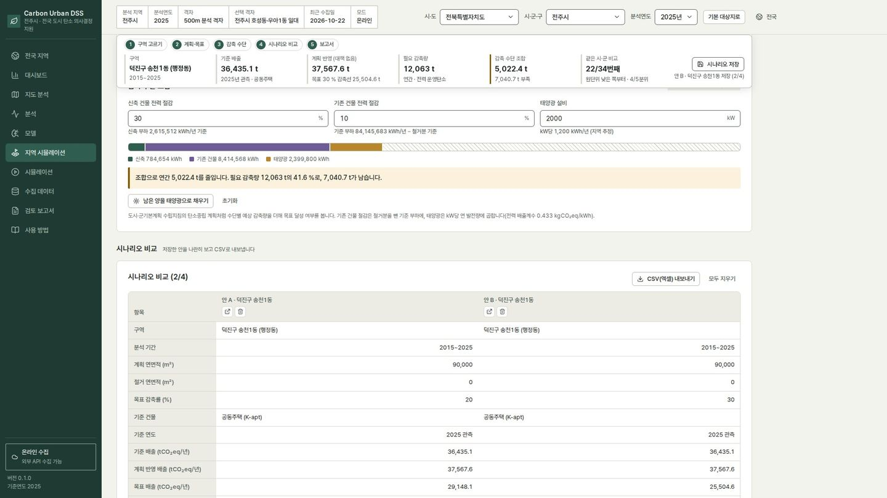

**보고서** (⑤): 제목(선택)을 넣고 **현재 조건으로 보고서 작성**을 누릅니다.

- "로컬 AI로 요약 문장 쓰기"를 켜도 숫자는 근거 문장에서만 옵니다(7절).
- **마크다운 내려받기**를 할 수 있습니다.
- 인쇄·PDF용 보기는 핵심 결과 표와 기후변화영향평가서 온실가스 항목 순서로 구성됩니다.

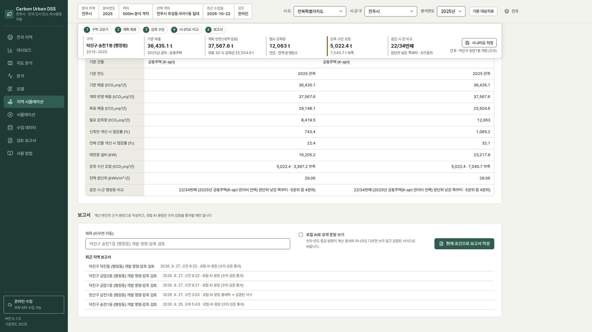

**링크 복사**: 구역·기간·계획·목표·기준 건물·감축 수단을 주소 하나로 복사합니다. 다른 사람·다른 PC에서 열면 같은 입력으로 시작합니다(9.3절).

링크가 머리의 분석 지역을 바꾸면 머리 아래에 다음 알림이 나옵니다. **확인**을 누르거나 이전 지역으로 되돌립니다.

> 이 링크가 분석 지역을 ○○로 바꿨습니다

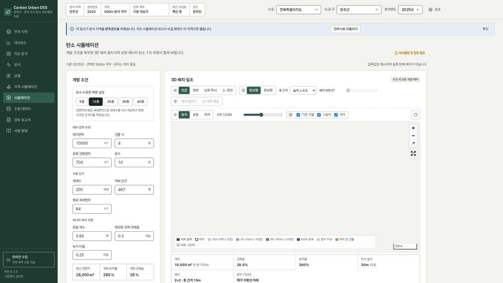

### 4.7 시뮬레이션 (3D 계획안)

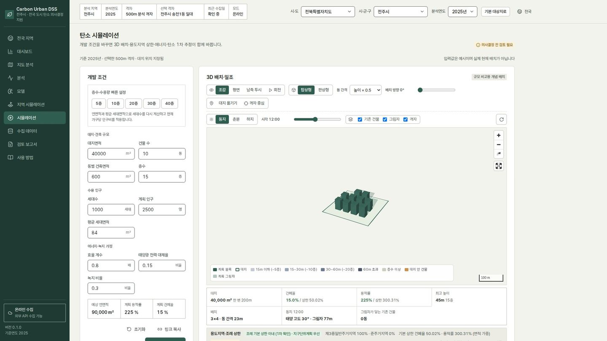

**입력 항목**

| 그룹 | 항목 | 단위 | 설명 |
|---|---|---|---|
| 층수·수용량 빠른 설정 | 5·10·20·30·40층 | — | 연면적과 평균 세대면적으로 세대수를 다시 계산하고 지금 가구당 인구비를 적용 |
| 대지·건축 규모 | 대지면적, 건물 수, 동별 건축면적, 층수 | m², 동, m², 층 | 연면적 = 동수 × 건축면적 × 층수. 기본값은 4동 × 700m² × 10층(용적률 280%) |
| 수용 인구 | 세대수, 계획 인구, 평균 세대면적 | 세대, 명, m² | 세대수 × 세대면적 ≤ 연면적 |
| 에너지·녹지 가정 | 효율 계수 | 배 | 1.0 = 지역 관측 원단위 그대로, 0.8 = 20% 고효율 |
| | 태양광 전력 대체율 | 0~1 | 0.15 = 전력의 15%를 태양광으로 상쇄 |
| | 녹지 비율 | 0~1 | 공간 제약에만 씀(에너지에 곱하지 않음) |

입력 아래에 예상 연면적·계획 용적률·건폐율이 바로 나오고, **초기화**·**링크 복사**·**시나리오 계산** 단추가 있습니다.

**3D 배치·일조**

| 조작 | 내용 |
|---|---|
| 시점 | 조감 · 평면 · 남측 투시 · 회전 |
| 배치 | 탑상형 · 판상형, 동 간격(높이 대비), 배치 방향(회전) |
| 대지 위치 | **대지 옮기기**(지도 클릭) / 격자 중심 |
| 일조 | 동지 · 춘분 · 하지, 시각(한국 시간) |
| 레이어 | 기존 건물 · 그림자 · 격자 |

3D 아래에는 다음이 나옵니다.

- 대지·건폐율·용적률(상한 대비)·최고 높이, 그림자가 닿는 기존 건물 수
- **용도지역·조례 상한 1차 확인**: 대지에 걸친 용도지역 비율, 면적 가중 기본 상한, 이내/초과, 지구단위계획 대상 규모

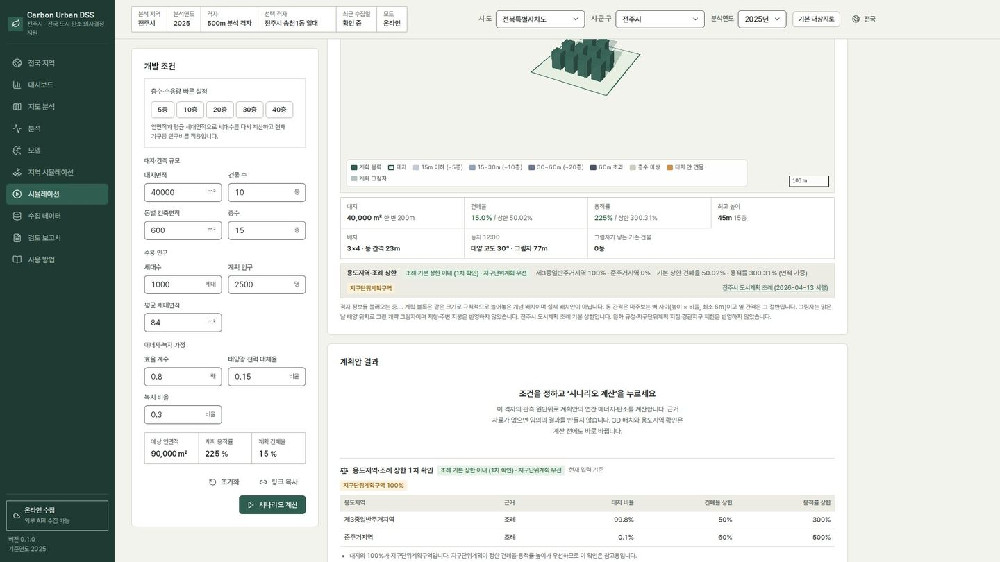

**시나리오 계산 결과**

| 결과 | 내용 |
|---|---|
| 한눈에 보는 네 칸 | **연간 운영탄소**(전력+가스, t), **기준안 대비 절감률**(같은 연면적을 효율 1.0·태양광 0으로 지을 때와 비교), **1인당·세대당 운영탄소**, **조례 상한 1차 확인** |
| 보고서 작성 단추 | 3D 장면을 저장하고 이 계획안의 보고서를 바로 엶 |
| 규모 띠 | 연면적·용적률(상한)·건폐율(상한)·건축면적 |
| 계획안·기준안 표 | 전력·가스·전력 탄소·가스 탄소 |
| 월별 운영탄소 그래프 | 계획안 실선, 기준안 점선 |
| 산정 방법과 가정 | 접혀 있음 |

대상지는 격자 ID 대신 지명(예: 전주시 송천1동 일대)으로 적습니다.

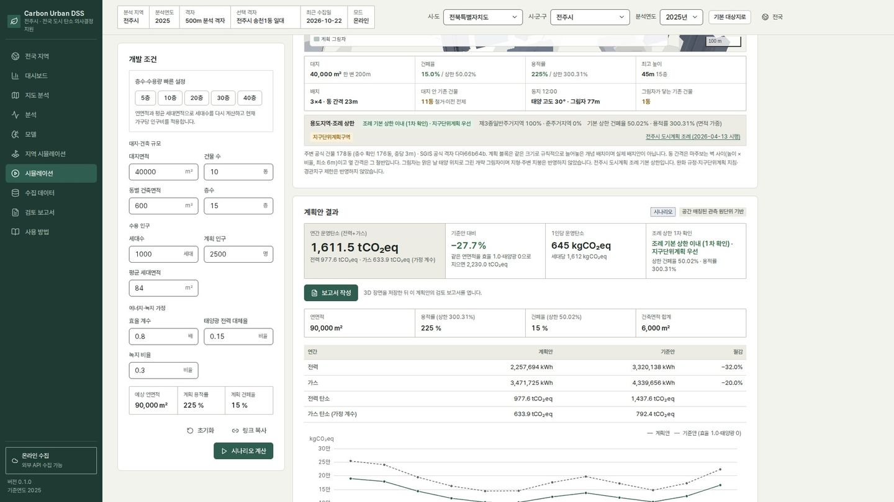

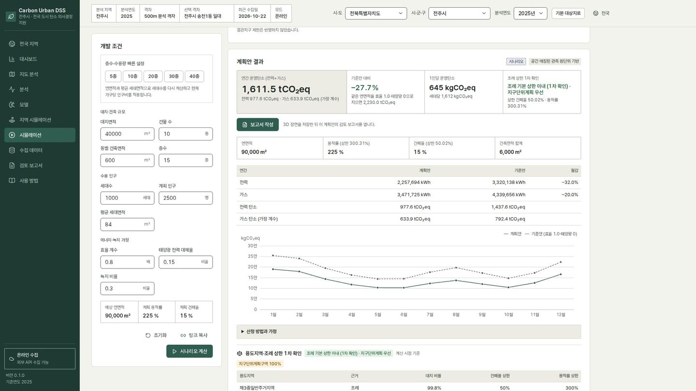

**도시구조 최적화**: 최소 세대수·인구를 넣고 **최적안 탐색**을 누릅니다.

- 대지의 법적 상한 안에서 층수·동수 조합을 모두 계산해 후보 셋을 보여 줍니다. 탄소 최소 · 세대당 탄소 최소 · 수용량 최대입니다.
- "이 조건을 입력에 적용"으로 바로 3D에 반영합니다.

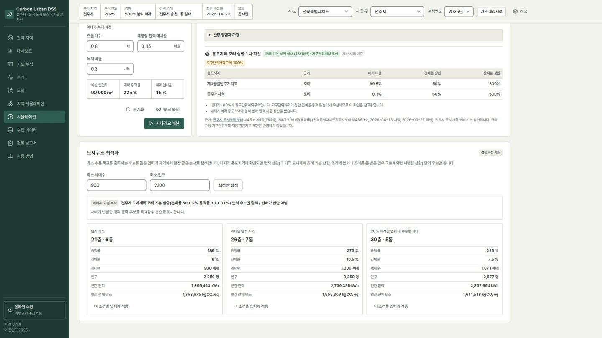

### 4.8 검토 보고서

**계획안 보고서**

- 시뮬레이션 결과의 **보고서 작성**을 누르면 그 계획안의 보고서가 바로 만들어집니다.
- 이 화면에서 같은 대상지·연도의 다른 계획안을 더 고르면 비교표가 함께 들어갑니다. 최대 3개이고, 고른 순서로 A·B·C입니다.
- 계획안 없이 **현황 보고서**만 쓸 수도 있습니다.

**보고서 구성** (7절)

1. 핵심 결과: 계획안별 카드, 3D 개념 배치 그림, 요약 문장
2. 대상지 개요
3. 계획 개요 표
4. 에너지·탄소 산정 표와 월별 그래프
5. 용도지역·조례 상한 확인
6. 유의사항
7. 자료 출처와 배출계수

**내보내기**: **문서 내려받기**(마크다운)와 **인쇄**(PDF로 저장). **작성 이력**에서 예전 보고서를 다시 엽니다.

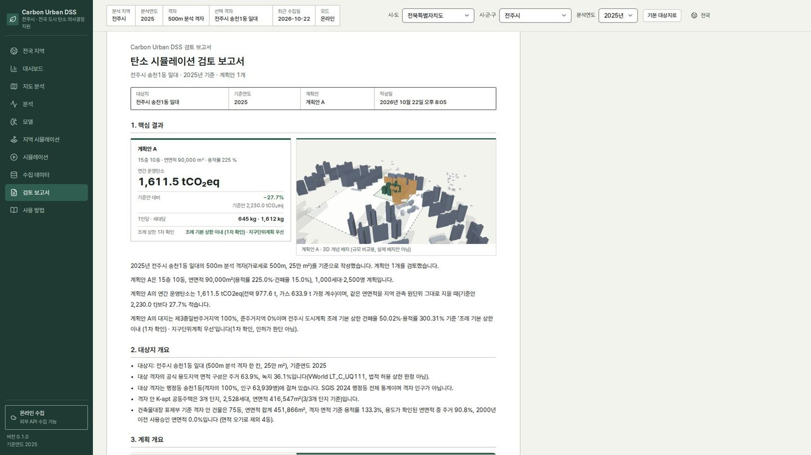

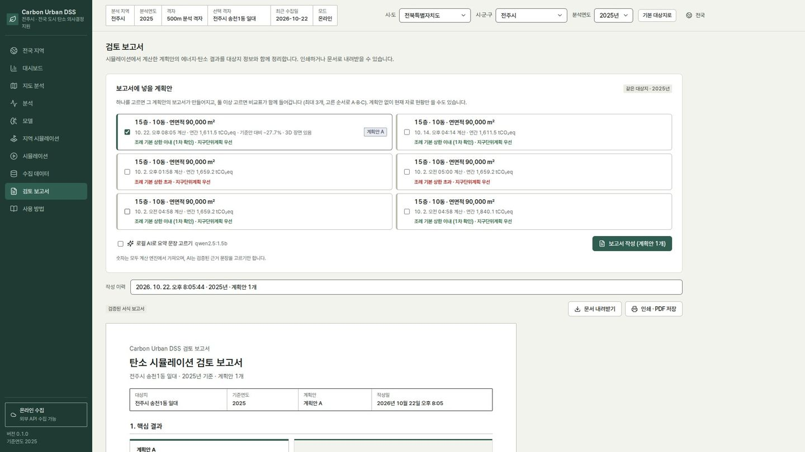

### 4.9 수집 데이터

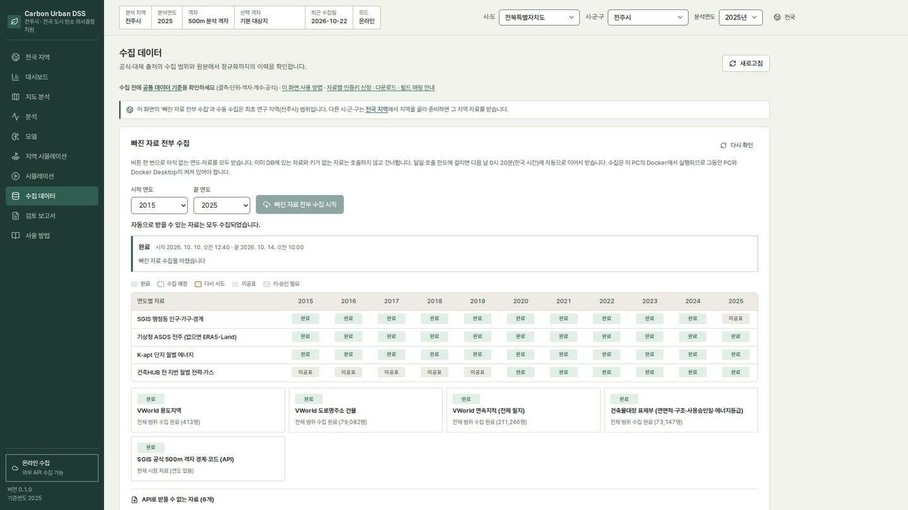

| 부분 | 내용 |
|---|---|
| **빠진 자료 전부 수집** | 시작·끝 연도를 고르고 버튼 한 번으로 아직 없는 연도·자료를 모두 받음. 이미 있는 자료와 키가 없는 자료는 건너뜀 |
| 연도별 표 | 완료 · 수집 예정 · 다시 시도 · 미공표 · 키·승인 필요를 색으로 구분 (SGIS·기상·K-apt·건축HUB × 2015~2025) |
| 작업 상태 | 수집 중이면 진행 막대. **한도 초과**면 다음 날 00:20(KST)에 자동 재개(지금 바로 다시 시도 가능). **대기 중**이 20분 넘게 그대로면 화면을 열 때 작업자에게 다시 보내고, [대기 중 — 다시 요청]으로 직접 다시 보낼 수도 있음 |
| 머리 지역의 연도별 수집 진행 | 머리에서 전주 밖 시·군·구를 고르면 그 지역의 건축HUB·K-apt 연도별 상태(완료·일부·한도 대기·— = 받은 기록 없음) |
| 키·승인이 필요한 자료 / API로 받을 수 없는 자료 | 무엇을 어디서 신청하는지 안내 |
| 출처별 상태 카드 | 수집 상태·정규화 행·기준 기간·종합 품질. 누르면 원본·정규화 미리보기와 수집 이력 |
| 데이터 수집 요청 (고급) | 데이터셋·기간·범위(**첫 검증 → 일부 → 전체**)를 골라 하나씩. '전체'는 같은 출처의 '첫 검증'이 성공한 뒤에만 |
| 수동 파일 업로드 | 자료 종류와 파일을 고르면 인코딩·좌표계·열을 감지 → 열 매핑·제공기관·기준기간 입력 → 가져오기(원본은 그대로 보존) |
| 작업 이력 | 지난 수집 작업과 오류, 이후 해결된 오류 표시 |

이 화면의 '빠진 자료 전부 수집'과 수동 수집은 최초 연구 지역(전주시) 범위입니다. 다른 시·군·구는 전국 지역에서 준비합니다. 수집은 이 PC의 Docker에서 실행되므로 그동안 PC와 Docker Desktop이 켜져 있어야 합니다.

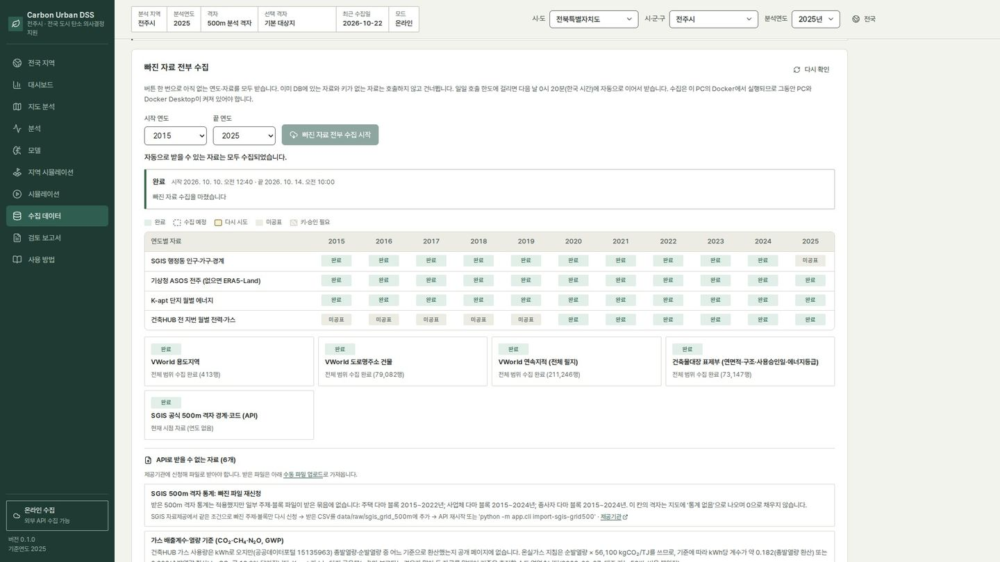

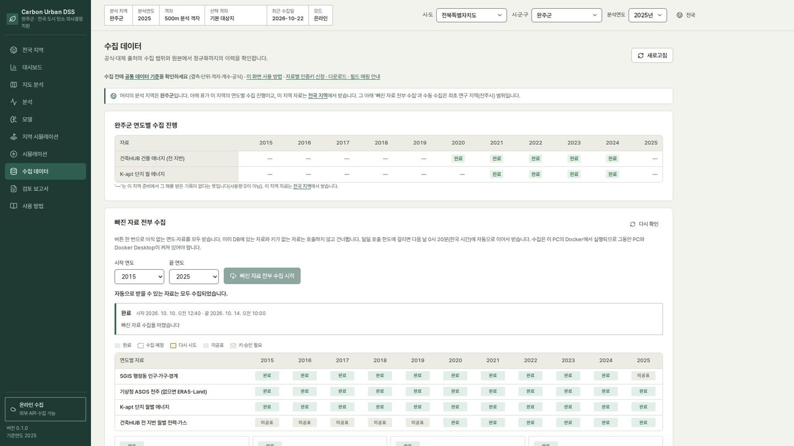

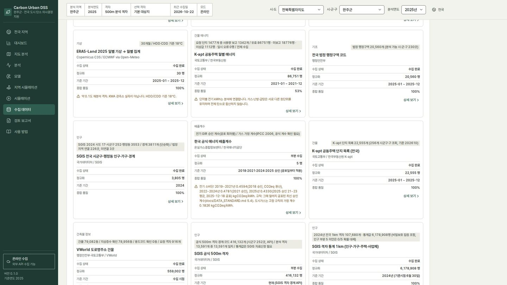

### 4.10 사용 방법

앱 안의 안내입니다.

- 처음 시작하기
- 데이터 기준(수집 전 필독, `check-standard` 점검 결과)
- 화면 구성
- 전국 지역·지역 준비
- 지도 정보와 활용(지표·레이어)
- 값 읽는 법
- 지역 시뮬레이션
- 격자 분석·계획안·검토 보고서
- 자료 수집
- SGIS 격자 통계
- 인증키 설정
- 로컬 AI
- 문제 해결

다른 화면의 "사용 방법" 링크는 이 안내의 해당 절로 바로 엽니다.

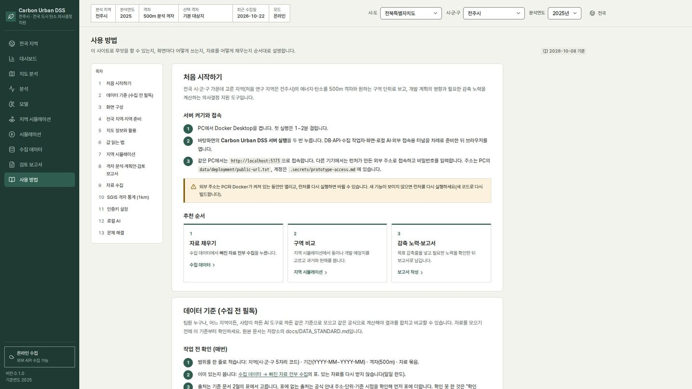

---

## 5. 실습: 지역을 골라 시뮬레이션하기

아래 25개 사례는 `backend/cases/simulation_cases.json`에 입력값 그대로 저장되어 있고, `verify-cases` 명령이 같은 값을 다시 계산해 비교합니다(9절). 사례마다 ① 화면에서 입력하는 순서, ② 그대로 열리는 **사례 링크**, ③ 화면에 나와야 하는 결과(2026-10-08 자료), ④ 해석을 적었습니다.

> **자료 날짜 주의.** 아래 결과 값은 2026-10-08 자료 묶음 기준입니다. 그 뒤 PC에 에너지 연도를 더 받았으므로, 지금 PC 자료로 열면 에너지·감축 값이 다를 수 있습니다(10/21 점검: 25개 중 9개 일치, 16개는 새 에너지 자료 때문에 다름, 용도지역·계획안·최적안 사례는 모두 일치). 10/08 묶음을 가져온 PC에서는 그대로 나옵니다(9절).

### 5.0 사례 목록

| ID | 지역 · 구역 | 성격 | 메뉴 | 핵심 입력 |
|---|---|---|---|---|
| D01~D04 | 전주·수원·강동·부산 강서 | 자료 지문 | (명령) | 계산이 읽는 행 수·합계 |
| J01 | 전주 덕진구 송천1동 (에코시티) | 개발지 | 지역 시뮬레이션 | +9만 m², −20%, 공동주택 |
| J02 | 〃 | 개발지 | 지역 시뮬레이션 | J01과 같고 기준 건물만 건물 전체 |
| J03 | 전주 완산구 효자5동 (서부신시가지) | 상업지 | 지역 시뮬레이션 | +7.5만 m², −20%, 건물 전체 |
| J04 | 전주 상업지역이 가장 넓은 격자 18개 | 상업지 | 지역 시뮬레이션 | +5만 m², −20%, 건물 전체 |
| J05 | 에코시티 대지 중심 반경 1km | 개발지 | 지역 시뮬레이션 | +4만 m², −30%, 태양광 1,200 직접 |
| J06 | 에코시티 격자, 3종일반주거 대지 | 개발지 | 시뮬레이션 3D | 4만 m² 대지, 10동×15층, 1,000세대, 일반 |
| J07 | 〃 | 개발지 | 시뮬레이션 3D | J06 + 고효율 0.8 + 태양광 15% |
| J08 | 〃 (대지를 격자 중심에) | 개발지 | 시뮬레이션 3D | J06과 같고 대지 위치만 다름 |
| J09 | 〃 | 개발지 | 최적안 탐색 | 900세대·2,200명 이상 |
| J10 | 서부신시가지 격자, 중심상업 대지 | 상업지 | 시뮬레이션 3D | 1만 m² 대지, 2동×25층 주상복합 600세대 |
| J11 | 〃 | 상업지 | 최적안 탐색 | 500세대·1,200명 이상 |
| J12 | 에코시티 대지 | 개발지 | 법적 상한 | 용적률 225%·건폐율 15% 판정 |
| J13 | 에코시티 격자 | 개발지 | 검토 보고서 | 계획안 A·C 비교 |
| J14 | 송천1동 | 개발지 | 지역 보고서 | J01 조건 |
| S01 | 수원 영통구 광교1동 (광교신도시) | 개발지 | 지역 시뮬레이션 | +6만 m², −20%, 공동주택 |
| S02 | 수원 팔달구 인계동 | 상업지 | 지역 시뮬레이션 | +6만 m², −20%, 건물 전체 |
| S03 | 수원 기본 대상지 격자 | 비교 | 시뮬레이션 3D | J06과 같은 계획안 |
| G01 | 서울 강동구 고덕2동 (재건축 대단지) | 개발지 | 지역 시뮬레이션 | +6만 m², −20%, 공동주택 |
| G02 | 서울 강동구 천호3동 (상업지역 격자) | 상업지 | 지역 시뮬레이션 | +4만 m², −20%, 건물 전체 |
| B01 | 부산 강서구 명지1동 (명지국제신도시) | 개발지 | 지역 시뮬레이션 | +6만 m², −20%, 공동주택 |
| B02 | 부산 강서구 명지1동 상업 중심 격자 | 상업지 | 지역 시뮬레이션 | +3만 m², −20%, 건물 전체 |

> 사례 링크의 `http://localhost:5173`은 자기 PC 주소입니다. 공개 주소로 접속했다면 그 주소로 바꿔 씁니다.

### 5.1 J01 · 전주 개발지 송천1동(에코시티) — 개발 전후와 감축 20%

**입력 순서**

1. 위쪽 범위: 시·도 `전북특별자치도` → 시·군·구 `전주시` → 분석연도 `2025년`.
2. 메뉴 **지역 시뮬레이션** → 구역 방식 `행정동` → `덕진구 송천1동`.
3. 시작 연도 `2015`, 끝 연도 `2025`.
4. 아래 **미래 개발과 감축 노력**: 연면적 직접 → 추가 연면적 `90000`, 철거 `0`, 목표 감축률 `20`, 기준 건물 `공동주택 (K-apt)`, 태양광 발전량은 **비움**.

사례 링크: `http://localhost:5173/area?region=52110&area=admin:35012650&from=2015&to=2025&window=3&plan=90000&target=20&basis=apartments`

**화면에 나와야 하는 결과**

| 항목 | 값 | 종류 |
|---|---|---|
| 구역 | 격자 19개 · 단지 38곳 | — |
| K-apt 12개월 관측 전력 | 2019: 14,374,920 · 2020: 62,485,075 · 2023: 77,741,971 · 2025: **84,145,683 kWh** | 관측 |
| 2015~2018 전력 | 자료 없음 | — |
| 건물 전체 전력(건축HUB) 2025 | 171,888,267 kWh (12개월 계측 지번 489곳) | 관측 |
| 같은 지번 비교 2021→2025 | 414곳 84,437,430 → 139,498,797 kWh (+65.2%) | 계산 |
| 개발 연도(자동) | 2019년: 단지 5개 3,345세대 사용승인 | 관측 |
| 개발로 늘어난 부하(추정) | 단지 연면적 +527,251 m²(+28.1%) → 전력 약 +15,377,255 kWh/년 | 추정 |
| 기준(2025) 전력 탄소 | **36,435.1 t** (원단위 29.06 kWh/m², 연면적 2,782,908 m²) | 계산 |
| 개발 후, 추가 대책 없음 | 37,567.6 t | 시나리오 |
| 목표(−20%) | 29,148.1 t | 시나리오 |
| **필요 감축량** | **8,419.5 tCO2eq/년** | 시나리오 |
| 신축만 효율화 | 743.4% 필요 → 불가 | 시나리오 |
| 지역 전체 건물 효율 개선 | **22.4%** | 시나리오 |
| 재생에너지 상쇄 | 19,444,649 kWh/년 | 시나리오 |
| 태양광 설비 | **16,205.2 kW** (2025 ASOS 일사량 1,500 kWh/m² × 0.80 = 1,199.9 kWh/kW·년, 추정) | 추정 |

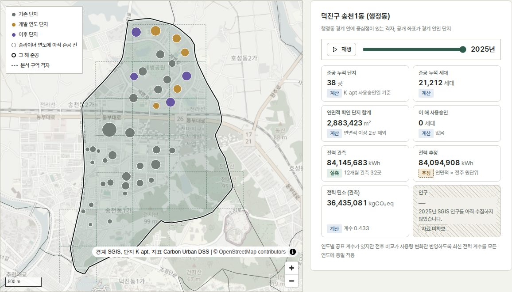

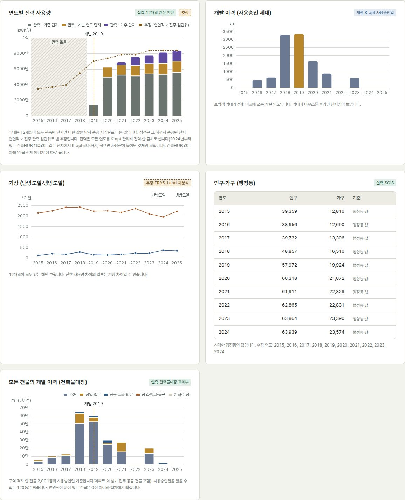

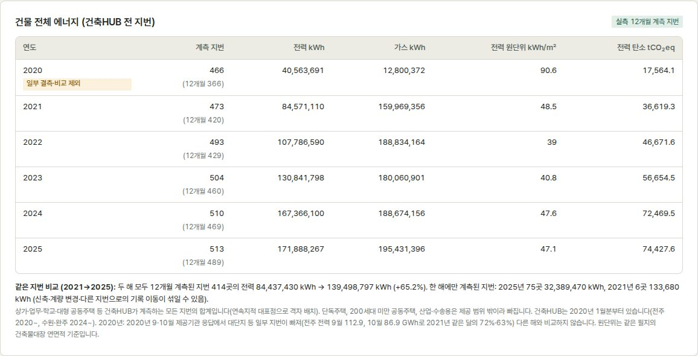

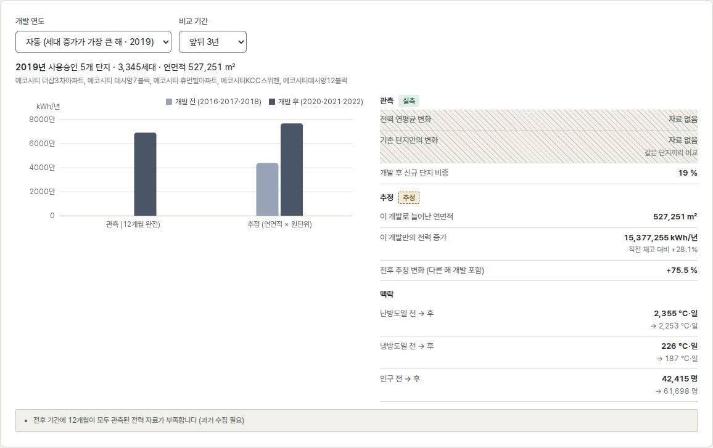

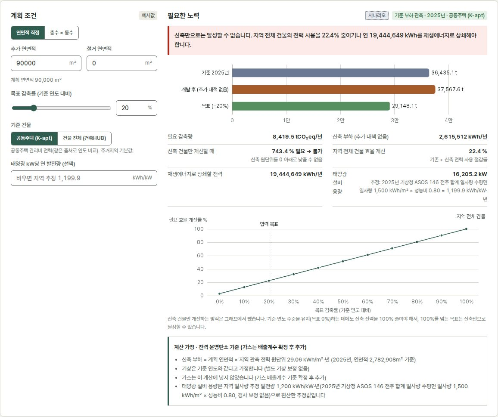

**해석**: 2019년 에코시티 단지 입주로 지역 공동주택 연면적이 28% 늘었고, 관측이 없는 2016~2018년 대신 연면적 × 원단위로 추정하면 연 1,538만 kWh가 늘었습니다. 앞으로 9만 m²를 더 지으면서 2025년보다 20% 줄이려면 신축만으로는 불가능하고(743%), 지역 공동주택 전체가 전력을 22.4% 줄이거나 태양광 약 16 MW가 필요합니다.

### 5.2 J02 · 같은 지역, 기준 건물을 "건물 전체"로

J01에서 **기준 건물**만 `건물 전체 (건축HUB)`로 바꿉니다. 링크: `…&basis=buildings`

| 항목 | 공동주택 기준 (J01) | 건물 전체 기준 (J02) |
|---|---:|---:|
| 기준 전력 2025 | 84,145,683 kWh | 171,888,267 kWh |
| 기준 탄소 | 36,435.1 t | 74,427.6 t |
| 필요 감축량 | 8,419.5 t | 16,720.2 t |
| 지역 전체 효율 개선 | 22.4% | 21.9% |
| 태양광 | 16,205.2 kW | 32,181.7 kW |

**해석**: 감축률(%)은 비슷하지만 절대량(t, kW)은 기준 건물 범위에 따라 2배 차이가 납니다. 보고서·발표에서는 반드시 **기준 건물과 기준 연도**를 함께 적습니다([기준 6절](DATA_STANDARD.md#6-보고서-작성-기준)).

### 5.3 J03 · 전주 상업지 효자5동(서부신시가지) — 건물 전체 기준

입력: 행정동 `완산구 효자5동`, 2015~2025, 추가 연면적 `75000`, 목표 `20`, 기준 건물 **`건물 전체 (건축HUB)`**.
링크: `http://localhost:5173/area?region=52110&area=admin:35011790&from=2015&to=2025&window=3&plan=75000&target=20&basis=buildings`

| 항목 | 값 |
|---|---|
| 구역 | 격자 26개 · 단지 17곳 |
| 건물 전체 전력 2025 | 160,874,572 kWh (K-apt 단지 전력 25,112,588 kWh의 약 6.4배) |
| 기준 탄소 / 개발 후 / 목표 | 69,658.7 t / 71,810.5 t / 55,727.0 t |
| 필요 감축량 | **16,083.5 t/년** |
| 신축만 / 지역 전체 효율 | 747.4% → 불가 / **22.4%** |
| 태양광 | **30,956.3 kW** (1,199.9 kWh/kW·년 추정) |

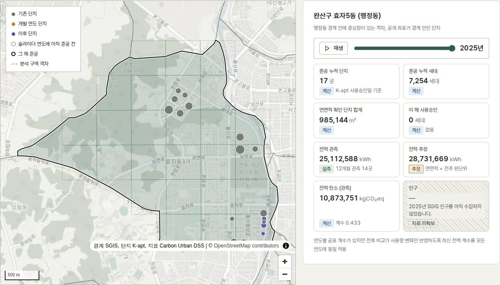

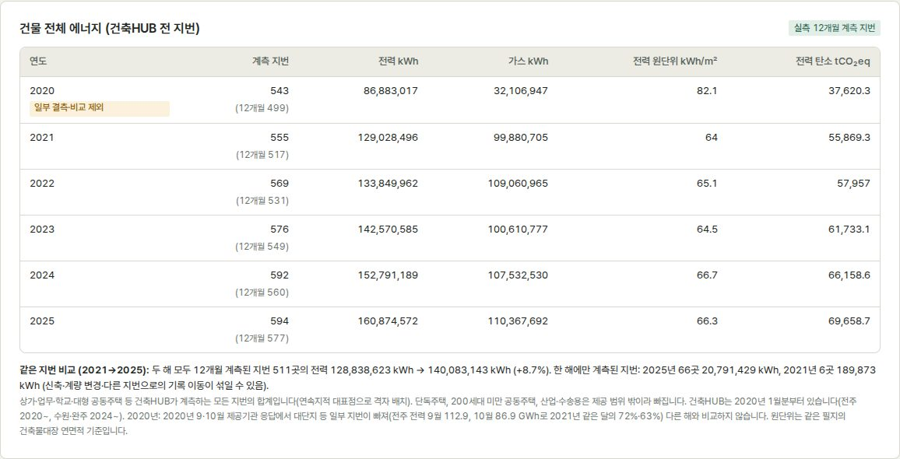

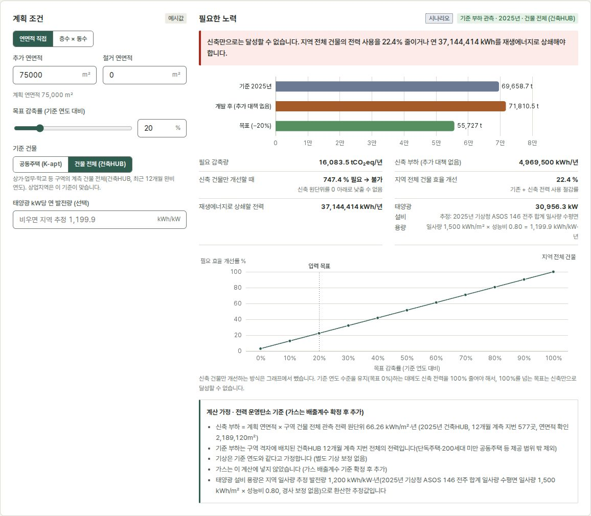

**해석**: 상업지는 상가·업무 건물이 부하의 대부분이라 공동주택 기준으로 계산하면 목표가 실제 부하의 일부에만 걸립니다. 상업지는 **건물 전체** 기준을 씁니다.

### 5.4 J04 · 용도지역으로 고르기, J05 · 반경과 태양광 직접 입력

**J04** 구역 방식 `용도지역` → `상업지역` (상업지역이 가장 넓은 격자 18개), +50,000 m², −20%, 건물 전체.
링크: `…/area?region=52110&area=zone:COMMERCIAL&from=2015&to=2025&window=3&plan=50000&target=20&basis=buildings`
→ 기준 전력 299,191,877 kWh, 기준 탄소 129,550.1 t, 필요 감축 **27,595.9 t**, 지역 전체 효율 **21.0%**, 태양광 53,114.3 kW.

**J05** 구역 방식 `반경(지도 클릭)` → 지도에서 에코시티 대지(위도 35.880124, 경도 127.13219) 클릭 → 반경 `1000` m, +40,000 m², 목표 **30**%, 공동주택, 태양광 발전량 **`1200`** 직접 입력.
링크: `…/area?region=52110&area=circle:127.13219,35.880124,1000&from=2015&to=2025&window=3&plan=40000&target=30&pv=1200&basis=apartments`
→ 격자 12개·단지 15곳, 기준 전력 49,208,945 kWh, 필요 감축 **6,860.6 t**, 지역 전체 효율 **31.5%**, 태양광 **13,203.6 kW**(사용자 입력 1,200 kWh/kW).

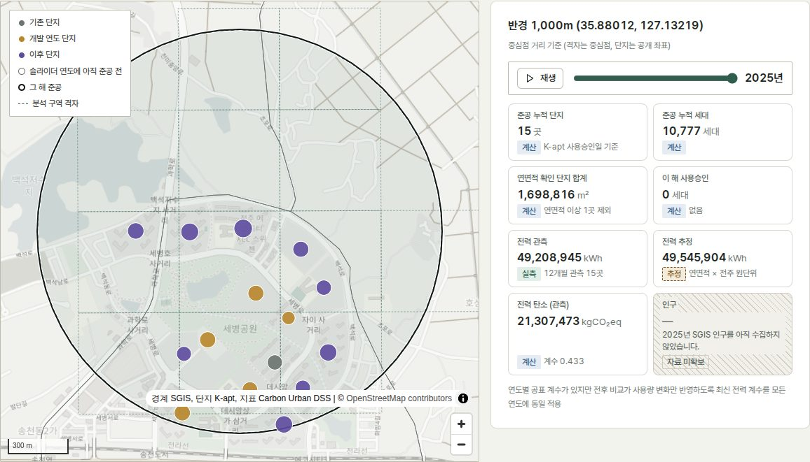

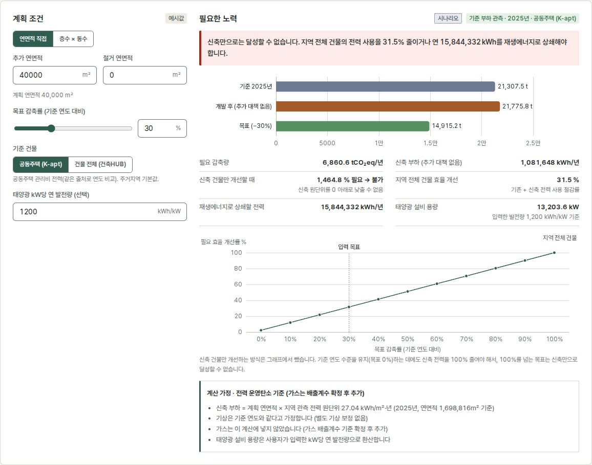

### 5.5 J06·J07 · 3D 계획안 A(일반)와 C(고효율 + 태양광)

**입력 순서 (J06 계획안 A)**

1. 범위: `전주시`, 2025년. 지도 분석에서 격자 `cell_966500_1764500`(에코시티)를 선택하거나 사례 링크로 엽니다.
2. 메뉴 **시뮬레이션** → 3D 패널 **대지 옮기기** → 지도에서 3종일반주거 부지(위도 35.880124, 경도 127.13219) 클릭.
3. 개발 조건: 대지면적 `40000`, 건물 수 `10`, 동별 건축면적 `600`, 층수 `15`, 세대수 `1000`, 계획 인구 `2500`, 평균 세대면적 `84`, 효율 계수 `1`, 태양광 `0`, 녹지 `0.3`.
4. **시나리오 계산** → **보고서용 장면 저장**.

사례 링크(A): `http://localhost:5173/simulation?region=52110&grid=cell_966500_1764500&year=2025&site=127.132190,35.880124,0&site_area=40000&building_count=10&footprint_per_building=600&floors=15&households=1000&population=2500&efficiency_factor=1&pv_ratio=0&green_ratio=0.3&average_household_area=84&min_households=900&min_population=2200`
계획안 C(J07)는 같은 링크에서 `efficiency_factor=0.8&pv_ratio=0.15`.

| 항목 | A 일반 (J06) | C 고효율 0.8 + 태양광 15% (J07) |
|---|---:|---:|
| 연면적 · 용적률 · 건폐율 | 90,000 m² · 225% · 15% | 같음 |
| 연간 전력 | 3,320,137.9 kWh | 2,257,693.7 kWh |
| 연간 가스 | 4,339,656.2 kWh | 3,471,725.0 kWh |
| **연간 전체 탄소(전력+가스)** | **2,230,040.9 kg (2,230.0 t)** | **1,611,518.4 kg (1,611.5 t), A 대비 −27.7%** |
| 1인당 탄소 | 892.0 kg | 644.6 kg |
| 전력 최대 달 | 8월 | 8월 |
| 대지 용도지역 | 제3종일반주거 99.85%, 준주거 0.15% | 같음 |
| 조례 상한 | 건폐율 50.02% · 용적률 300.31% → **이내** (지구단위계획구역 100%: 지구단위계획 우선) | 같음 |
| 현재(격자 관측 기준값) | 10,321,305 kg | 같음 |

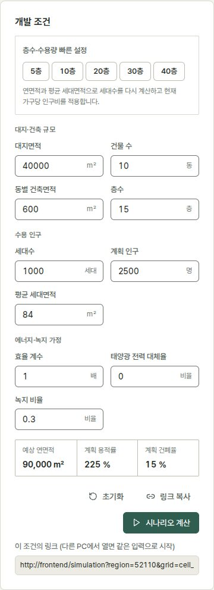


**해석**: "현재"는 이 격자에서 12개월 관측된 공동주택 지번 전체의 합계(기준값)이고, 계획안 값은 계획 연면적 × 관측 원단위입니다. 두 값의 차이는 "감축"이 아니라 규모 차이이므로, **계획안끼리(A ↔ C) 비교**합니다.

### 5.6 J08 · 대지 위치에 따라 상한이 달라짐

J06과 입력이 같고 **대지를 옮기지 않은 경우**(격자 중심) 대지의 65.81%가 자연녹지지역이라 면적 가중 상한이 용적률 168.38% · 건폐율 30.26%로 낮아지고, 계획 용적률 225%는 **조례 기본 상한 초과**로 나옵니다. 탄소 값은 같습니다(대지 위치는 법적 상한에만 영향).
링크: J06 링크에서 `site=…&` 부분을 뺍니다.

### 5.7 J09 · 최적안 탐색 (개발지)

J06 화면(계획안 A 입력 그대로: 효율 1.0, 태양광 0) 아래 **도시구조 최적화**: 최소 세대수 `900`, 최소 인구 `2200` → **최적안 탐색**.

| 후보 | 층수 × 동수 | 세대 | 용적률 | 연간 전체 탄소 |
|---|---|---:|---:|---:|
| 탄소 최소 | 21층 × 6동 | 900 | 189.0% | 1,873,234 kgCO2eq |
| 세대당 탄소 최소 | 21층 × 6동 (같은 후보) | 900 | 189.0% | 1,873,234 kgCO2eq |
| 20% 범위 내 수용량 최대 | 30층 × 5동 | 1,071 | 225.0% | 2,230,041 kgCO2eq |

1,748개 조합 중 165개가 조례 상한(건폐율 50.02%·용적률 300.31%)과 수용 조건을 만족했습니다.


### 5.8 J10·J11 · 상업지 주상복합 (서부신시가지)

입력: 격자 `cell_964500_1757500`, 대지 위치 (위도 35.815588, 경도 127.109795), 대지 `10000`, 2동 × 25층, 동별 `1500` m², 600세대, 1,500명, 녹지 0.2.
링크: `http://localhost:5173/simulation?region=52110&grid=cell_964500_1757500&year=2025&site=127.109795,35.815588,0&site_area=10000&building_count=2&footprint_per_building=1500&floors=25&households=600&population=1500&efficiency_factor=1&pv_ratio=0&green_ratio=0.2&average_household_area=84&min_households=500&min_population=1200`

| 항목 | 값 |
|---|---|
| 연면적 · 용적률 · 건폐율 | 75,000 m² · **750%** · 30% |
| 연간 전력 · 가스 | 3,391,785.6 kWh · 3,715,872.9 kWh |
| 연간 전체 탄소 | 2,147,161.6 kg |
| 용도지역 | 중심상업지역 100% → 조례 상한 용적률 **700%** · 건폐율 80% → **초과** (지구단위계획구역) |
| 최적안 (J11, 500세대·1,200명 이상, 효율 1.0) | 190개 중 38개가 상한(700%) 안. 탄소 최소 28층 × 1동 500세대 용적률 420% 1,202,410 kgCO2eq · 수용량 최대 33층 × 1동 589세대 495% 1,417,127 kgCO2eq |


### 5.9 J12 · 법적 상한 1차 확인만 하기

대지 (127.13219, 35.880124), 4만 m², 회전 0°, 용적률 225% · 건폐율 15% · 1,000세대 →
용도지역 제3종일반주거 99.85% · 준주거 0.15%, 조례 상한 건폐율 50.02% · 용적률 300.31%, 지구단위계획구역 1곳, 판정 **"조례 기본 상한 이내 (1차 확인) · 지구단위계획 우선"**. 화면의 3D 패널은 계산 전에도 이 확인을 바로 보여 줍니다(API: `GET /api/zoning/site`).

### 5.10 J13 · 격자 보고서 (계획안 A·C 비교)

J07(C)을 먼저 계산 → **보고서 작성**(3D 장면 저장 뒤 보고서 화면으로) → 같은 화면에서 J06(A)을 계산해 두었다면 계획안 목록에서 A를 추가로 체크 → **보고서 작성**. 보고서의 "계획안 A·B"는 **고른 순서**를 따릅니다(사례 파일은 A=J06, B=J07 순).

| 보고서 항목 | 값 (10/08 자료, 사례 파일 기준) |
|---|---|
| 계획안 A (J06) | 15층 10동, 연면적 90,000 m², 용적률 225.0%, 연간 운영탄소 2,230.0 t, 기준안 2,230.0 t (효율 1.0·태양광 0이라 같음) |
| 계획안 B (J07) | 같은 배치, 연간 1,611.5 t, 기준안 대비 −27.7% |
| 근거 문장 | 계획안 문장 6개(규모·탄소·상한 × 2) + 격자 문장 6개 — 10/14부터 지명·계획안 A·B·기준안 비교로 바뀜(근거 문장 규칙 v3, 값은 그대로) |
| 유의사항 | 7개 |
| 장 구성 | 7장 (핵심 결과 ~ 자료 출처) |


### 5.11 J14 · 지역 보고서

J01 화면 맨 아래 **보고서** → 제목(선택) → **현재 조건으로 보고서 작성**. "로컬 AI로 요약 문장 쓰기"를 켜면 로컬 모델이 문장을 쓰되, 숫자·연도·증감 방향이 근거와 하나라도 다르면 쓰지 않고 검증된 서식으로 바꿉니다. 보고서에는 근거 문장 23개, 표(연도별 관측, 건물 전체 에너지, SGIS 지역 특성), 감축 계산의 가정, 근거 SHA-256이 들어갑니다. **마크다운 내려받기**로 문서를 받습니다.


### 5.12 S01~S03 · 수원 (다른 지역에서 같은 절차)

범위를 `경기도` → `수원시`로 바꾸면 같은 화면이 수원 자료로 계산합니다.

| 사례 | 입력 | 결과 |
|---|---|---|
| S01 광교1동 (개발지) | +60,000 m², −20%, 공동주택 | 격자 32·단지 24, K-apt 2025 55,050,348 kWh, 기준 23,836.8 t, 필요 감축 **5,385.1 t**, 지역 효율 **22.0%**, 태양광 **10,571.8 kW** (ERA5 일사량 1,470 kWh/m² × 0.80 = 1,176.4 kWh/kW, 추정) |
| S02 인계동 (상업지) | +60,000 m², −20%, 건물 전체 | 격자 11·단지 20, 건축HUB 2025 234,250,661 kWh, 기준 101,430.5 t, 필요 감축 **22,275.9 t**, 지역 효율 **21.5%**, 태양광 **43,731.3 kW** |
| S03 기본 대상지 + J06 계획안 | 격자 `cell_950000_1919000`, 대지 격자 중심 | 연간 탄소 1,818,730.4 kg(전력 4,017,974.3 · 가스 432,352.1 kWh: 지역난방 단지가 많아 가스가 작음). 제3종일반주거 79.8%·자연녹지 19.1%·2종 1.1% → 수원시 조례 가중 상한 용적률 **205.11%** → 225%는 **초과** |

링크: S01 `…/area?region=41110&area=admin:31014620&from=2015&to=2025&window=3&plan=60000&target=20&basis=apartments`, S02 `…/area?region=41110&area=admin:31013560&…&plan=60000&target=20&basis=buildings`, S03 `…/simulation?region=41110&grid=cell_950000_1919000&year=2025&site_area=40000&building_count=10&footprint_per_building=600&floors=15&households=1000&population=2500&efficiency_factor=1&pv_ratio=0&green_ratio=0.3&average_household_area=84`


**해석**: 같은 계획안이 전주 3종일반주거 대지에서는 상한 이내, 수원 기본 대상지에서는 자연녹지가 섞여 상한 초과입니다. 지역을 바꾸면 **조례·용도지역·관측 원단위가 모두 그 지역 것으로** 바뀝니다.

### 5.13 G01·G02 · 서울 강동구

| 사례 | 입력 | 결과 |
|---|---|---|
| G01 고덕2동 (재건축 개발지) | +60,000 m², −20%, 공동주택 | 격자 10·단지 5, K-apt 2025 26,760,667 kWh, 기준 11,587.4 t, 필요 감축 **2,937.7 t**, 신축만 473.7%(불가), 지역 효율 **24.1%**, 태양광 **5,899.5 kW** (ERA5 1,438 kWh/m² → 1,150 kWh/kW). 개발 연도 2019(추정 증가 22,691,635 kWh/년) |
| G02 천호3동 (상업지역 격자가 있는 상업지) | +40,000 m², −20%, 건물 전체 | 격자 4·단지 13, 건축HUB 2025 107,072,181 kWh(12개월 계측 지번 470곳, 원단위 78.40 kWh/m²), 기준 46,362.3 t, 필요 감축 **10,630.3 t**, 신축만 782.9%(불가), 지역 효율 **22.3%**, 태양광 **21,348.2 kW** |

강동구는 2026-10-08에 준비해 2025년 자료만 있습니다. 2020~2024 건축HUB와 과거 K-apt가 들어오면 개발 전후 관측 비교가 가능해지고, 그때 사례 값도 다시 기록합니다(9.4절).


### 5.14 B01·B02 · 부산 강서구

| 사례 | 입력 | 결과 |
|---|---|---|
| B01 명지1동 (명지국제신도시 개발지) | 행정동 `21120590`, +60,000 m², −20%, 공동주택 | 격자 49·단지 20 (2015~2021 사용승인 17,059세대), K-apt 2025 62,822,983 kWh, 원단위 27.54 kWh/m², 기준 27,202.4 t, 필요 감축 **6,155.9 t**, 지역 효율 **22.1%**, 태양광 **10,986.7 kW** (ERA5 1,618 kWh/m² × 0.80 = 1,294 kWh/kW, 추정) |
| B02 명지1동 상업 중심 격자 | 격자 `cell_1128000_1678500`, +30,000 m², −20%, 건물 전체 | 건축HUB 2025 24,162,764 kWh(지번 14곳, 원단위 49.07 kWh/m²), K-apt 6,579,257 kWh, 기준 10,462.5 t, 필요 감축 **2,729.9 t**, 지역 효율 **24.6%**, 태양광 **4,872.2 kW** |

링크: B01 `…/area?region=26440&area=admin:21120590&from=2015&to=2025&window=3&plan=60000&target=20&basis=apartments`, B02 `…/area?region=26440&area=grid:cell_1128000_1678500&from=2015&to=2025&window=3&plan=30000&target=20&basis=buildings`

> 부산 강서는 2026-10-08 준비가 끝났지만 격자의 주된 용도지역이 대부분 "기타"로 분류되어 용도지역으로 상업지를 고를 수 없습니다(원인 확인 필요: 표본 격자에서 세부 구분이 없는 "도시지역" 도형이 보임). 그래서 B02는 명지1동에서 **건물 전체 전력 − 공동주택 전력이 가장 큰 격자**로 골랐습니다. 이 분류 문제는 팀원 과제(T3)로 점검합니다.

---

## 6. 결과 읽는 법

| 표시 | 뜻 | 주의 |
|---|---|---|
| 신축만 개선 "743.4% → 불가" | 새 건물 전력을 100% 넘게 줄여야 함 = 신축만으로는 목표 불가 | 기존 건물까지 포함한 "지역 전체 효율"을 봄 |
| 지역 전체 효율 22.4% | 기존 + 신축 건물 전력을 모두 그만큼 줄이면 목표 달성 | 기상은 기준 연도와 같다고 가정 |
| 태양광 kW (추정) | 필요한 상쇄 kWh ÷ 지역 발전량(일사량 × 0.80) | 경사 보정·그늘·설치 면적 미반영. 사용자 값이 있으면 그 값 |
| 현재 vs 시나리오 (3D) | 격자 관측 합계 vs 계획 연면적 × 원단위 | 차이는 감축이 아님. 계획안끼리 비교 |
| 지역 평균 기준 (BAU) | 격자에 관측이 없어 지역 평균 원단위로 추정 | "추정" 배지 |
| 조례 상한 이내/초과 | 대지 용도지역 면적 가중 상한과 계획 비교 | 지구단위계획·완화 규정 우선, 인허가 판단 아님 |
| 자료 없음, 빗금 | 관측 없음(0 아님) | 빠진 자료는 수집 데이터에서 채움 |
| 2020년 "일부 결측·비교 제외" | 제공기관 9·10월 일부 지번 누락 | 다른 해와 비교하지 않음 |
| 연도별 전력의 "일부 단지" 빗금·흐린 막대 | 그해 관측 단지가 가장 잘 관측된 해의 절반 미만 | 막대가 낮아도 사용량이 준 것이 아님 |
| 흐린 숫자와 "비교 주의" | 개발 전후 관측 범위가 달라 지역 합계 변화에 수집 범위 차이가 섞임 | "기존 단지만의 변화"를 봄 |
| 분석연도 "(자료 없음)" | 서버 기준연도 뒤의 해 | 기준연도 이하를 고름 |

---

## 7. 보고서

1. **숫자의 출처**: 모든 숫자는 계산 엔진이 만든 근거 문장에서만 옵니다. 로컬 AI(Ollama `carbon-area-narrator-v3`, 2026-10-10부터. 6개 지역 자료로 학습)는 문장을 다듬을 뿐이고, 검증기가 숫자·연도·증감 방향·감축 기준을 대조해 하나라도 다르면 AI 문장을 버리고 검증된 서식으로 씁니다.
2. **재현 정보**: 보고서 ID와 근거 SHA-256이 끝에 들어갑니다. 같은 자료·같은 입력이면 근거 문장이 같습니다(AI 문장은 PC 성능에 따라 표현이 다를 수 있으나 숫자는 같음).
3. **기준 표기**: 감축량 문장에는 기준 건물(공동주택 K-apt / 건물 전체 건축HUB)과 기준 연도가 함께 들어갑니다.
4. **보관**: 보고서는 DB에 저장되고(작성 이력), 마크다운·인쇄(PDF)로 내보냅니다. 이후 자료가 바뀌어도 저장된 보고서는 바뀌지 않습니다.
5. **인쇄·PDF용 보기**(지역 보고서, 아래 그림은 송천1동 표본의 첫 쪽): 맨 위 핵심 결과 표(기준, 기준 배출, 계획 반영 배출, 목표, 필요 감축량, 감축 수단 조합, 행정동 비교) 다음에 기후변화영향평가서 온실가스 항목 순서(검토 대상과 방법 → 배출 현황 → 개발 이력과 전후 영향 → 감축 목표와 필요 감축량 → 감축 방안 → 지역 특성 → 자료 범위와 한계)로 근거 문장을 빠짐없이 싣습니다. 마크다운의 절·표 구성은 그대로입니다(사례 J14).


---

## 8. 자료를 더 모으기

| 하려는 일 | 방법 |
|---|---|
| 빠진 연도·자료를 한 번에 (전주) | 앱 **수집 데이터 → 빠진 자료 전부 수집**, 또는 `scripts\dss.cmd CollectHistory -FromYear 2015 -ToYear 2025` |
| 새 지역 상세 준비 | **전국 지역**에서 시·군·구 선택 → **상세 자료 수집**, 또는 `… python -m app.cli prepare-region --region 52140` |
| 준비한 지역의 과거 건축HUB | `… python -m app.cli region-energy-history --region 11740 --years 2024,2023,2022,2021,2020` |
| 준비한 지역의 과거 K-apt | `… python -m app.cli region-kapt-history --region 52710,41110 --years 2020,2019,2018,2017,2016,2015` (한도에서 멈추고 다음 실행이 이어 받음, 연도별 상태는 지역 기록 `kapt_years`) |
| 여러 지역을 며칠에 걸쳐 (대량) | PC 실행기 작업 `bulk_collect.py kapt` / `bulk_collect.py prep` (아래) |
| 지적도에 없는 계량 지번 위치 | `… python -m app.cli place-parcels --region 52110` (같은 본번 → 주소 좌표 순, 못 찾으면 그대로 둠) |
| 일사량(태양광 추정) | `… python -m app.cli backfill-solar` |
| 받은 파일 넣기 | `data/raw/<출처>/`에 원본 그대로 두고 수집 데이터 → 수동 파일 업로드 |
| 끝난 뒤 점검 | `… python -m app.cli check-standard` |

자료를 모으기 전에 **[공통 데이터 기준](DATA_STANDARD.md) 0절**을 매번 확인합니다.

**한도와 대량 수집 (2026-10-22)**

- 공공데이터포털은 서비스마다 하루 한도가 있습니다. 개발계정 기준 K-apt 5,000건, 건축HUB 10,000건입니다. 한도에 걸리면 다음 날 00:20(앱)·00:25(대량 수집 작업)에 이어 받습니다.
- K-apt는 운영계정으로 바꾼 뒤(10/14) 하루 5,000건을 넘겨도 한도에 걸리지 않았습니다. 다만 게이트웨이가 **연결당 초당 1건**으로 제한해 한 흐름은 하루 최대 약 8만 건입니다.
- 대량 수집은 PC 실행기에서 한 번에 두 갈래로 돕니다. 한 갈래는 준비한 지역의 K-apt 과거 연도, 다른 갈래는 전북 남은 시·군의 지역 준비와 건축HUB 과거 연도입니다.
  - 1회용 컨테이너에서 돌아 api를 다시 빌드해도 끊기지 않습니다.
  - 지역 준비는 작업자와 같은 잠금을 잡아 겹치지 않습니다.
- 진행: PC `data\ops\claude-runner\out\bulk-kapt.json`·`bulk-prep.json`. 범위·완성도 표: [자료 범위](DATA_COVERAGE.md).
- **수집하는 동안 PC와 Docker를 켜 두고 [Carbon DSS 끄기]를 누르지 않습니다.**

---

## 9. 다른 PC에서 같은 결과 확인하기

### 9.1 원리

같은 결과가 나오려면 **같은 코드 + 같은 자료 + 같은 입력**이어야 합니다.

| 같아야 하는 것 | 맞추는 방법 |
|---|---|
| 코드 | GitHub `main`의 같은 커밋 (`git log -1`) |
| 자료 | 같은 자료 묶음(`ExportBundle` → `ImportBundle`/`MergeBundle`): DB 덤프 + `data/raw` + 수집 완료 표시 |
| 입력 | 사례 파일(`backend/cases/simulation_cases.json`)·사례 링크 |

### 9.2 사례 검증 명령 (`verify-cases`)

```powershell
# 기본 사례 파일(저장소의 backend/cases/simulation_cases.json)과 비교
scripts\dss.cmd VerifyCases
# 받은 자료 묶음에 들어 있던 사례 파일과 비교
scripts\dss.cmd VerifyCases -CasesPath D:\share\simulation_cases.json
# 직접 실행
docker compose -p carbon-urban-dss -f compose.yaml -f compose.demo.yaml exec -T api python -m app.cli verify-cases
```

출력 예:

```
[일치] D01 전주시 자료 지문 (계산이 읽는 행 수·합계) — 값 25개
[일치] J01 전주 개발지 · 송천1동(에코시티) 개발 전후와 감축 20% (공동주택 기준) — 값 54개, 근거 문장 23개
...
결과: 25개 사례 모두 일치 — 이 PC의 계산 결과는 기준 PC(2026-10-08T…)와 같습니다.
```

- 계산은 **읽기만** 합니다. 계획안·보고서를 DB에 저장하지 않습니다(격자 보고서의 계획안은 계산 중에만 쓰고 되돌림).
- 숫자는 상대 오차 100만분의 1(최소 0.01) 안이면 같다고 봅니다. 근거 문장은 글자 하나까지 같아야 합니다.
- **근거 문장 규칙 버전**: 사례 파일의 `fact_rules`(없으면 1)와 코드의 규칙 버전(`app.cases.FACT_RULES`, 2026-10-10부터 2)이 다르면 문장은 비교하지 않고 값만 비교하며, 로그에 "근거 문장 규칙이 … 달라 문장 n개는 비교하지 않았습니다"라고 적습니다. 규칙 2는 개발 전후 문장이 실제 관측 연도를 적고(예: "개발 전 관측 1개 연도(2018) 평균"), 개발 전 관측 단지가 개발 후 기존 단지보다 적으면 "관측 범위 차이가 섞여 있음"과 같은 단지끼리의 변화를 함께 적도록 바꾼 것입니다(전주 송천1동처럼 2018년 K-apt를 일부만 받은 경우 지역 합계 +1,051.0%가 실제 증가처럼 읽히던 문제). 2026-10-08 자료 묶음의 사례 파일은 규칙 1로 기록되어 있어 최신 코드로는 값만 비교합니다.
- **자료 지문(D01~D04)이 다르면** 계산이 아니라 DB 자료가 다른 것입니다. 같은 날짜의 자료 묶음을 가져왔는지 확인합니다.
- 자료 지문에는 **건축HUB 연도별 "수집 완료" 표시**(`hub_year_complete.2020~2025`)도 들어 있습니다. 이 표시는 DB가 아니라 `data/ops/history-progress.json`에 있고, 완료가 아닌 해는 "잠정값"으로 쓰이며 감축 역산의 기준 연도가 되지 못합니다. 그래서 자료 묶음에 `collection-progress.json`으로 함께 담기고 `ImportBundle`이 되살립니다. 전주 밖의 준비 지역은 이 파일 대신 DB의 지역 기록(지역 준비 연도, `region-energy-history`가 끝낸 연도)으로 판단하므로 묶음의 DB와 함께 옮겨집니다. `MergeBundle`(자기 DB에 더하기)은 이 표시를 바꾸지 않으므로, 기준 PC와 비교할 때는 작업 지시서의 "따로 확인"(별도 프로젝트에 `ImportBundle`)으로 합니다.
- 결과 전체는 `--out` 파일(JSON)에 남습니다(`scripts\dss.cmd VerifyCases`는 `data\ops\<시각>-verifycases\cases-check.json`).

### 9.3 사례 링크

지역 시뮬레이션·시뮬레이션의 **링크 복사**는 지역·구역·격자·대지 위치·입력값을 주소에 담습니다. 받은 사람이 열면 같은 입력으로 시작하고, 같은 자료 묶음이면 같은 숫자가 나옵니다. 직접 그린 구역은 링크로 옮길 수 없습니다.

### 9.4 기준값을 새로 기록할 때 (자료를 가진 PC)

자료가 바뀌면(새 연도 수집, 지역 준비) 사례 값도 바뀝니다. 자료 묶음을 만들 때 `ExportBundle`이 **같은 DB 상태에서** 사례를 다시 계산해 묶음 안 `simulation_cases.json`에 기록하므로, 묶음과 기준값은 항상 짝이 맞습니다. 저장소의 사례 파일을 갱신하려면:

```powershell
docker compose -p carbon-urban-dss -f compose.yaml -f compose.demo.yaml exec -T api python -m app.cli verify-cases --record /data/ops/simulation_cases.json --note "자료 묶음 이름"
# data\ops\simulation_cases.json을 backend\cases\simulation_cases.json으로 옮겨 커밋
```

### 9.5 새 PC 모의 점검 (`VerifyBundle`)

```powershell
scripts\dss.cmd VerifyBundle -OutDir F:\carbon-dss-bundles
```

묶음 내보내기 → 현재 커밋을 깨끗한 폴더에 `git clone` → 그 폴더의 실행기로 **별도 프로젝트**(`carbon-urban-dss-importtest`, 포트 8010/5190)에 `ImportBundle` → 행 수·화면 확인 → **사례 25개 재계산·비교** → 별도 프로젝트 정리. `-OutDir`을 주면 묶음과 복제 폴더를 그 드라이브에 만들고 끝나면 복제 폴더를 지웁니다(C 드라이브 공간이 부족할 때).

이미 만든 묶음(예: 팀원에게 준 묶음)이 **지금 코드**에서도 같은 값을 내는지는 내보내기 없이 확인합니다.

```powershell
scripts\dss.cmd VerifyBundle -BundlePath F:\전북대\선도소프트\팀원전달_20261008\carbon-dss-bundle-20261008-050941.zip -OutDir F:\carbon-dss-bundles
```


### 9.6 점검 기록 (2026-10-08)

| 점검 | 방법 | 결과 |
|---|---|---|
| 같은 DB, 새 프로세스 | 기록 직후 `verify-cases`로 다시 계산 (사례가 22개였던 시점) | 22/22 일치 |
| 자료가 다를 때 (음성 시험) | 기록 시점이 다른 기준값과 비교 | 15 일치 · 7 다름, "자료가 다름" 안내, 종료 코드 1 (의도한 결과) |
| 프로젝트 폴더 이동 뒤 | 같은 PC, `F:\전북대\선도소프트`에서 `verify-cases` (03:26 기준값) | 25/25 일치 |
| 새 PC 모의 1차 | `VerifyBundle`: 커밋 6058e69 깨끗한 clone + 별도 Docker 프로젝트에 묶음 가져오기 | 59개 표 행 수는 같음, 사례 **12/25** |
| 새 PC 모의 2차 (수정 뒤) | `VerifyBundle`: 커밋 0815161, 묶음 `carbon-dss-bundle-20261008-050941` | 59개 표 행 수 같음, 화면 확인 통과, 사례 **25/25 일치** |
| 같은 묶음 + 최신 코드 | `VerifyBundle -BundlePath`: 커밋 1ad6abc(지역별 완료 여부 수정 포함), 팀원에게 준 묶음 그대로 | 59개 표 행 수 같음, 화면 확인 통과, 사례 **25/25 일치** (10/08 18:41) |
| 실제 다른 PC | 팀원 PC에서 `ImportBundle` | 아직 하지 않음 (팀원 과제 G3) |
| 같은 PC, 새 자료 (10/21) | 최신 코드·지금 DB로 `verify-cases`(비교만) | 9 일치 · 16 다름(모두 10/08 뒤 새 에너지 자료와 근거 문장 규칙 판). 용도지역·계획안·최적안 사례 일치. 기준값은 다시 기록하지 않음 |

1차에서 다른 13개 사례는 모두 같은 원인이었습니다. 건축HUB 연도의 "수집 완료" 표시가 DB가 아니라 `data/ops/history-progress.json`에 있는데 묶음에 빠져, 새 PC에서는 2025년이 "잠정값"으로 쓰이고 감축 역산의 기준 연도가 사라졌습니다(지역 분석의 건물 전체 문장 3개 누락, 건물 전체 기준 감축 역산 "자료 없음"). 묶음에 `collection-progress.json`을 넣고 `ImportBundle`이 되살리도록 고쳤고, 자료 지문에 연도별 완료 표시를 넣어 같은 일이 생기면 "자료가 다름"과 원인이 바로 나오게 했습니다. "새 PC 모의"는 같은 PC 안의 별도 폴더·별도 Docker 프로젝트이므로, 그래픽·CPU가 다른 실제 PC 확인은 팀원 PC에서 이어 합니다.

---

## 10. 문제 해결

| 증상 | 조치 |
|---|---|
| 화면이 열리지 않음 | 바탕화면 **[Carbon DSS 켜기]** → 2~4분 뒤 `http://localhost:5173` (또는 Docker Desktop 실행 → `docker compose … up -d`) |
| 안내 주소가 "연결되지 않습니다" | PC가 꺼짐·절전·로그온 전이거나 끄기 버튼으로 쉬는 중. [Carbon DSS 켜기]를 누르면 1분 안에 새 주소로 연결. 계속 안 되면 `data\ops\demo-watch.log` |
| 끈 뒤에도 Docker가 켜짐 | Docker Desktop 설정의 "Start when you sign in" 때문. 지킴이가 쉬는 동안 서비스는 올라오지 않으므로 그대로 두어도 되고, 끄려면 그 설정을 끔 |
| 링크를 열었더니 분석 지역이 바뀜 | 정상. 머리 아래 알림에서 **이전 지역으로 되돌리기** |
| 지도가 늘 다른 보기로 열림 | 마지막으로 본 보기를 기억함. 위 단계 링크(1·2·3)로 옮김 |
| "대기 중" 작업이 오래 그대로 | 20분이 넘으면 수집 데이터 화면을 열 때 작업자에게 다시 보냄. [대기 중 — 다시 요청]으로 직접 다시 보낼 수도 있음 |
| "자료 없음"과 빗금이 많음 | 아직 수집하지 않았거나 제공기관이 공표하지 않은 값. 수집 데이터 → 빠진 자료 전부 수집 |
| 처음 고른 시·군·구가 바로 안 열림 | 전국 공통 자료로 기본 지도를 만드는 중(몇 초). 전국 지도는 처음 15~25초 |
| "한도 초과 — 자동 재개 대기" | 정상. 다음 날 00:20에 이어 받음(PC·Docker가 켜져 있어야 함) |
| 지역 시뮬레이션 첫 계산이 느림 | 그 지역·기간 자료를 처음 읽는 중(10~20초). 이후 몇 분 동안은 바로 계산 |
| 3D가 회색이거나 안 보임 | 브라우저 하드웨어 가속(WebGL) 켜기. 원격 데스크톱에서는 느릴 수 있음 |
| `verify-cases`에서 자료 지문이 다름 | 다른 날짜의 자료 묶음. 기준 PC의 최신 묶음을 다시 받거나, 묶음 안의 `simulation_cases.json`으로 비교 |
| `verify-cases`에서 자료 지문 중 "건축HUB ○○년 수집 완료 표시"만 다름 | 행은 같고 수집 완료 표시 파일만 다름. 같은 묶음으로 `ImportBundle`(자동 복원)하거나 묶음 안 `collection-progress.json`을 `data\ops\history-progress.json`으로 복사 |
| `verify-cases`에서 값만 다름(자료 지문은 같음) | 코드 판이 다를 수 있음: `git pull` → `scripts\dss.cmd Rebuild` 후 다시 실행. 그래도 다르면 `cases-check.json`을 팀에 공유 |
| `ImportBundle`이 "already has N tables"로 중단 | 대상 DB가 비어 있지 않음. 팀원 자료를 더하려면 `MergeBundle` |
| `환경변수 형식 오류` | `.env` 값이 예시 문구·한글·따옴표 포함. 실제 키로 바꾸고 api·worker 재생성 |

더 많은 항목: [팀원 PC 재현 4절](TEAM_SETUP.md#4-문제-해결), [사용 방법 13절](USAGE.md#13-문제-해결).

---

## 11. 한계와 주의

- 건축HUB는 단독주택·200세대 미만 공동주택을 제공하지 않아 지역 총량보다 작습니다(탄소공간지도 대비 칸별 비율 중앙값 0.67~0.76). 총량은 한전 시군구 전력·지역 인벤토리와 맞대어 봅니다.
- 가스 탄소는 가정 계수(0.1826)이고, 감축 노력 계산은 전력 기준입니다.
- 3D 배치는 규모 비교용 개념 배치이며, 일조·그림자는 맑은 날 태양 위치로 그린 개략도입니다.
- 법적 상한은 조례 기본 상한(없으면 시행령)이며 지구단위계획·완화 규정·경관지구 제한을 반영하지 않습니다.
- 개발 전후 비교는 관측이 있는 연도만 쓰고, 부족하면 연면적 × 원단위 추정으로 보완하며 "추정값"으로 표시합니다.
- 행정동 비교는 같은 시·군·구 안의 위치일 뿐 공식 등급(서울 건물에너지 등급, ENERGY STAR)이 아닙니다. 행정동마다 용도·연식 구성이 다르고 용도 보정을 하지 않습니다.
- 감축 수단 조합은 전력만 셉니다(가스 계수 확정 전). 비용·회수기간은 단가 근거가 없어 계산하지 않습니다.
- 시나리오 비교는 브라우저 저장이라 다른 PC와 공유되지 않습니다. CSV나 링크로 넘깁니다.
- 자세한 목록: [LIMITATIONS.md](LIMITATIONS.md).

---

## 부록 A. 계산식 요약

| 계산 | 식 |
|---|---|
| 지번 연간 에너지 | 12개월 모두 관측된 지번만 Σ 월 사용량 |
| 원단위 | I = E ÷ 같은 지번 건축물대장 연면적 (kWh/m²·년) |
| 전력 탄소 | C = E × F(y) (그해 말까지 공표된 최신 GIR 승인 계수) |
| 계획안 (3D) | 월별 계획 에너지 = 기준 격자 월별 원단위 × 계획 연면적 × 효율 계수, 전력은 × (1 − 태양광 대체율) |
| 개발 후(BAU) | E_bau = E_기준 + I × (추가 − 철거 연면적) |
| 필요 감축량 | ΔC = E_bau × F − E_기준 × F × (1 − 목표%) |
| 지역 전체 효율 | ΔC ÷ C_bau × 100 |
| 신축만 효율 | ΔC ÷ (I × 추가 연면적 × F) × 100 |
| 태양광 kW | ΔC ÷ F ÷ (일사량 kWh/m² × 0.80) |
| 개발 전후 | 개발 연도 앞 w년 평균 vs 뒤 w년 평균 (개발 연도 제외) |

전체 식과 기준: [공통 데이터 기준 5절](DATA_STANDARD.md#5-계산-공식).

## 부록 B. 용어

| 용어 | 뜻 |
|---|---|
| 500m 격자 | EPSG:5179 좌표 500m 정사각형 칸, ID `cell_<왼쪽아래 x>_<y>` |
| 건축HUB | 국토교통부 건물에너지(지번 × 월 전력·가스) |
| K-apt | 공동주택관리정보시스템(단지 × 월 관리비 에너지) |
| 기준 건물 | 감축 계산의 기준 부하 범위: 공동주택(K-apt) / 건물 전체(건축HUB) |
| BAU | 추가 대책 없이 계획만 반영한 상태 |
| 사례 링크 | 화면 입력을 담은 주소 |
| 자료 지문 | 계산이 읽는 행 수·합계(같은 자료인지 확인용) |
| 근거 문장 | 계산 엔진이 숫자와 함께 만든 문장, 보고서 숫자의 유일한 출처 |

## 부록 C. 명령어 모음

| 명령 | 용도 |
|---|---|
| 바탕화면 [Carbon DSS 켜기]·[Carbon DSS 끄기] / `scripts\dss-power.ps1 -Mode On\|Off\|Status` | 켜기·끄기·상태 (2.4절) |
| `scripts\dss.cmd Doctor` | 사전 점검 |
| `scripts\dss.cmd ImportBundle -BundlePath <zip>` | 새 PC에 자료 묶음 넣기(+사례 검증) |
| `scripts\dss.cmd MergeBundle -BundlePath <zip> -DryRun` | 팀원 묶음 더하기 전 세기 |
| `scripts\dss.cmd ExportBundle [-OutDir <폴더>]` | 자료 묶음 만들기(+사례 기록) |
| `scripts\dss.cmd VerifyCases [-CasesPath <json>]` | 사례 재계산·비교 |
| `scripts\dss.cmd VerifyBundle [-OutDir <폴더>] [-BundlePath <zip>]` | 새 PC 모의 점검 (묶음을 주면 내보내기 없이 그 묶음으로) |
| `scripts\dss.cmd CollectHistory` | 빠진 과거 자료 수집 |
| `… python -m app.cli check-standard` | 데이터 기준 점검 |
| `… python -m app.cli verify-cases [--only J01,J06] [--out <json>]` | 사례 재계산·비교 |
| `… python -m app.cli prepare-region --region <코드>` | 지역 상세 준비 |
| `… python -m app.cli region-energy-history` / `region-kapt-history --region <코드> --years …` | 준비한 지역의 과거 건축HUB / K-apt |

`…` = `docker compose -p carbon-urban-dss -f compose.yaml -f compose.demo.yaml exec -T api`

## 부록 D. 사례 입력값

사례 25개의 입력 전체와 기준 PC 값·근거 문장은 [`backend/cases/simulation_cases.json`](../backend/cases/simulation_cases.json)에 있습니다. 각 사례의 `input`은 화면이 API로 보내는 값과 같습니다(지역 시뮬레이션: `POST /api/areas/analyze`, 시뮬레이션: `POST /api/scenarios`, 최적안: `POST /api/optimize`, 법적 상한: `GET /api/zoning/site`).

## 부록 E. 사용 영상

이 매뉴얼의 4절을 실제 화면으로 따라가는 영상입니다. 나레이션·자막·배경음악이 들어 있습니다.

- 파일: `Carbon-Urban-DSS-사용안내.mp4`(1920×1080) · 자막 `Carbon-Urban-DSS-사용안내.srt`. 받은 폴더 또는 PC의 프로젝트 폴더 `docs\video\`
- 영상 파일은 크기가 커서 Git에 올리지 않습니다. 대본과 만드는 방법은 저장소 `scripts/video/`에 있습니다.
- 그림은 2026-10-22 PC 자료입니다. 1.5절의 PC 전용 기능은 실제 화면 대신 설명 카드로 넣었습니다.

| 장 | 내용 |
|---|---|
| 0 | 소개와 다루는 내용 |
| 1 | 켜기·끄기와 접속 (바탕화면 버튼, 안내 주소) |
| 2 | 화면 구성과 값 읽는 법 (메뉴, 표제란, 분석 범위, 배지) |
| 3 | 전국 지역 |
| 4 | 지도 분석 (3단계, 지표, 레이어, 격자 상세, 동별 비교, PC 전용 기능) |
| 5 | 대시보드 · 분석 · 모델 |
| 6 | 지역 시뮬레이션 (구역, 요약 막대, 과거와 현재, 개발 전후, 감축 노력, 행정동 비교, 수단 조합, 시나리오 비교, 보고서, 링크) |
| 7 | 시뮬레이션 (3D 계획안, 상한 확인, 계산 결과, 최적안) |
| 8 | 검토 보고서 |
| 9 | 수집 데이터 |
| 10 | 사용 방법과 마무리 |

