# 사용성·기능·화면·디자인 검토 (2026-10-13, 실데이터)

PC에서 돌아가는 실제 앱(실데이터 DB)을 브라우저 자동화로 열어 45번 측정했습니다(1차 34, 2차 11). 화면마다 아래 항목을 같이 쟀습니다.

- 로딩 시간
- 콘솔·API 오류
- 가로 넘침
- 작은 누름 영역
- 이름 없는 버튼과 입력칸
- 12px 미만 글자
- axe-core(WCAG 2.1 A/AA) 위반

진행 순서는 다음과 같습니다.

- 1차: 화면 33개를 데스크톱 1440, 노트북 1280, 태블릿 820, 모바일 390 폭으로 찍었습니다.
- 2차: 11개 조작을 따로 확인했습니다. 스크롤, 지도 격자 클릭, 반경 모드, 행정동 바꾸기, 키보드 이동, 2026년 선택, 시뮬레이션 계산 뒤 보고서 화면입니다.
- 검토 중 만든 보고서 1건과 계획안 2건은 id로 지웠습니다.

**측정 조건:** 시간은 같은 PC에서 자료 수집 작업이 함께 돌던 때 잰 값입니다. 수집은 외부 API 응답을 기다리는 시간이 대부분이지만, 아래 시간은 상한에 가까운 값으로 읽어 주세요.

## 0. 고친 상태 (2026-10-21)

F1~F19와 접근성 일부를 고쳤습니다(커밋 `사용성 검토(10/13) F1~F19 고치기`). 6절 6번(메뉴 이름·묶음, 고정 머리 접기)은 사용자 확인이 필요해 손대지 않았습니다.

**PC 확인(10/21 17:13~17:24, 실데이터 DB, 촬영 없음).**

- 프런트 테스트 48파일 183개 통과, 운영 빌드 통과. pytest(바꾼 모듈 12개) 107개 통과.
- 화면 측정에서 페이지 오류 0건, API 5xx 0건.
- 사례 검증(`verify-cases`, 비교만): 일치 9 · 다름 16 · 오류 0.
  - 다른 16건은 모두 10/08 기준 이후 새로 모은 에너지 자료와 근거 문장 규칙 판 차이(v1→v3)입니다(건물·K-apt 전력, 그 값을 쓰는 감축 기준, 근거 문장 수).
  - 용도지역이 들어가는 사례(J12 대지 용도지역·상한, J13 격자 보고서, 계획안·최적안)는 모두 일치했습니다. 용도지역 셈 변경(F1)으로 달라진 사례 값은 없습니다. 기준값은 다시 기록하지 않았습니다.

| # | 고친 내용 | 확인 |
|---|---|---|
| F1 | 세부 용도지역을 먼저 세고, 상위 도형(도시지역·관리지역)은 세부가 덮지 않은 면적만 '기타'로 셉니다. 범주마다 100%, 합계도 100%를 넘지 않습니다. | 군산 `cell_928500_1774500`: 주거 94.4 · 녹지 5.53 · 기타 0.07, 합 100%(전: 기타 100% + 주거 94.4% + 녹지 5.5%). pytest 4가지 경우 |
| F2 | 건물 용도는 건축물대장 표제부 주용도(연면적 기준)를 먼저 씁니다. VWorld는 용도를 아는 건물이 있을 때만 쓰고, 둘 다 없으면 사유를 적습니다. | 같은 칸: 대장 237동, 용도 3묶음, 합 100% |
| F3 | 지역 시뮬에서 8초가 지나면 "처음 한 번은 1~3분" 안내와 경과 초를 보여 줍니다. 서버 캐시는 이미 오래된 값을 먼저 주고 뒤에서 새로 계산합니다. | 화면 코드·테스트 |
| F4 | 사용 방법 본문 칸의 최소 폭과 표·코드 넘침을 막았습니다. | 가로 넘침 데스크톱 0px · 모바일 0px(전: 467px · 1,025px) |
| F5 | 요약 막대가 실제 머리 높이(`--shell-header-h`) 아래에 붙습니다. | 스크롤 뒤 머리 아래 117px, 막대 위 155px |
| F6 | 로딩 중에는 '불러오는 중'으로만 안내합니다(분석 SGIS·용도지역, 보고서 계획안, 지역 시뮬 빈 패널). | 화면 코드·테스트 |
| F7 | 범례 아이콘을 16×6px 둥근 막대로 키웠습니다. | 코드(차트 그림은 재지 않음) |
| F8 | 분석연도는 서버 기준연도(2025)까지만 둡니다. 예전 주소의 뒤 해는 '(자료 없음)'을 붙여 남깁니다. "건축HUB는 2024년부터" 문구를 고쳤습니다. | 선택지 2025~2015, 2026 없음 |
| F9 | 링크가 분석 지역을 바꾸면 머리 아래에 알리고 이전 지역으로 되돌릴 수 있게 했습니다. | `/simulation?region=52710` → "완주군으로 바꿨습니다", [전주시로 되돌리기] 뒤 원래 지역 |
| F10 | 수집 데이터 화면이 머리 지역의 연도별 수집 진행(건축HUB·K-apt)을 보여 주고, 아래 수집 버튼이 전주 범위라는 것을 함께 적습니다. | 완주군: 완료 9칸 · 기록 없음 13칸 |
| F11 | 20분 넘게 '대기 중'인 '빠진 자료 수집' 작업은 작업자에게 다시 보냅니다(중복 전달은 아무 일도 하지 않음). 대기 중에는 진행 막대를 숨기고 [다시 요청]을 열어 둡니다. | pytest 2개. 10/9 작업은 이미 SUCCESS로 끝나 있었음 |
| F12 | 관측 단지가 가장 잘 관측된 해의 절반이 안 되는 해는 '일부 단지' 해치와 흐린 막대로 그립니다. 비교 불가 값(+446.8% 같은)은 흐리게 하고 '비교 주의'를 붙입니다. | 송천1동: '비교 주의' 1곳 |
| F13 | 지도는 마지막으로 본 보기, 처음에는 시·군·구 보기로 엽니다. 격자 말풍선을 패널 위(z 5)로 올렸습니다. 왼쪽 패널 폭은 그대로입니다. | 첫 열기 '3. 시·군·구', 전국을 본 뒤 메뉴로 다시 열면 '1. 전국' |
| F14 | 시뮬레이션 기본 입력을 10층(용적률 280%)으로 바꿨습니다. | 층수 입력 10 |
| F15 | 없는 주소는 '없는 화면입니다'와 갈 수 있는 화면을 보여 줍니다. | `/does-not-exist` |
| F16·F17 | smoke·limited·full을 '첫 검증·일부·전체'로 바꿨습니다. 예전 기록 문장은 화면에서 바꿔 보여 줍니다. 출처 표 열 이름을 '마지막 수집 기간'으로 바꾸고 분석연도와 무관하다고 적었습니다. SGIS 문구는 '공표 전이거나 아직 받지 않음'입니다. | 분석·수집 화면에 개발 용어 0 |
| F18 | 소수 자리를 정한 지표는 자리수를 맞춥니다(39.0 · 48.5). 추정 연면적에 쉼표를 넣고, 숫자 칸은 줄을 바꾸지 않습니다. 모델 표본은 '1,656 / 120건'으로 씁니다. 보고서 감축 수단 표는 kWh 합계와 탄소 환산 합계(kgCO2eq)를 나눴습니다. | 테스트. 예전에 저장된 대상지 선정 사유 문장은 다시 계산할 때 바뀝니다 |
| F19 | "막대를 누르거나 마우스를 올리면"으로 바꿨습니다. | 화면 코드 |
| 접근성 | 본문으로 건너뛰기, 로딩 `role=status`·오류 `role=alert`, 업로드 라벨 2개, 진행률 `progressbar`, 작업 목록 키보드 초점, MapLibre 저작권 글자색 | 건너뛰기 1개, 업로드 라벨 2개 |
| 대비 | `--ink-3`을 #6B746E → #5E6761로 바꿨습니다(도면지 5.26, `--surface-sunk` 4.90, 결측 바탕 5.13). | `.muted` 계산색 rgb(94, 103, 97) |

**아직 하지 않은 것.**

- 12px 미만 글자 정리(대시보드 24개, 수집 데이터 50개, 지도 19개)
- 반응형 경계값 줄이기
- 지도 왼쪽 패널 묶기
- 페이지 안 이동 수단
- 메뉴 이름·묶음과 고정 머리 접기(6절 6번, 사용자 확인 필요)

'일부 단지' 해치와 범례 아이콘은 차트 그림이라 이번 측정에서 재지 않았습니다(코드·단위 테스트만).

## 1. 결론

**전주(자료가 갖춰진 지역)에서는 업무 흐름이 끝까지 오류 없이 돕니다.** 흐름은 다음과 같습니다.

- 지역 시뮬레이션: 구역 고르기 → 계획·목표 → 감축 수단 → 시나리오 저장 → 보고서 작성 → 인쇄·PDF

측정 45번 모두 자바스크립트 오류와 API 오류(4xx·5xx)가 0건이었습니다(페이지를 옮길 때 끊긴 요청만 있음). 인쇄용 보고서는 업무 문서로 쓸 수 있는 수준입니다.

**다만 지금 그대로 외부 업체에 내놓으면 바로 눈에 띄는 문제가 7가지 있습니다.**

| # | 문제 | 영향 |
|---|---|---|
| 1 | 지역을 처음 열거나 5분 쉬었다 다시 열면 **47초~3분 22초** 대기 | "멈췄다"로 보임 |
| 2 | **사용 방법** 화면이 옆으로 넘침(데스크톱 467px, 모바일 1,025px) | 모바일에서는 읽을 수 없음 |
| 3 | 용도지역 비율이 **겹쳐서 더해짐**. 예: 군산 '기타 100% + 주거 94.4% + 녹지 5.5%' | 값이 틀림 |
| 4 | 건물 용도 패널이 **모든 격자에서 '용도 미상 100%'** | 정보가 없는 패널 |
| 5 | 10/10에 넣은 지역 시뮬 **결과 요약 막대**가 스크롤하면 머리 뒤에 숨음 | 기능이 사실상 없음 |
| 6 | 차트 **범례의 색 표시가 보이지 않음**(전력/가스, 난방도일/냉방도일) | 색과 계열을 잇지 못함 |
| 7 | 로딩 중인데 **"수집하면 표시됩니다", "계획안이 없습니다"**로 안내 | 잘못된 행동을 유도 |

## 2. 기능이 정상인 것 (실측)

| 화면 | 확인한 동작 | 결과 |
|---|---|---|
| 지역 시뮬레이션(전주 송천1동) | 첫 화면, 요약, 감축 수단, 행정동 비교, 시나리오 저장, 보고서 작성 | 정상. 보고서 작성 27.6초(로컬 AI 끔) |
| 지역 시뮬레이션 | 행정동 바꾸기(여의동) | 1.5초 안에 다시 계산 |
| 지역 시뮬레이션 | 반경 모드 → 지도 클릭 | 정상(반경 1,000m 결과) |
| 인쇄·PDF용 보고서 | 핵심 결과 표, 7개 절, KST 작성 시각, 근거 SHA256 | 정상 |
| 지도(시·군·구 보기) | 격자 클릭 → 상세 패널, 머리의 '선택 격자' 갱신 | 정상 |
| 시뮬레이션 | 시나리오 계산, 3D 배치, 조례 상한 비교 | 정상 |
| 보고서(검토) | 전주 범위에서 계산한 계획안이 목록에 나옴 | 정상 |
| 키보드 | Tab 이동 시 포커스 링(2px #2E5A87)이 보이고 화면 안에 있음 | 정상 |
| 반응형 | 사용 방법을 뺀 32개 화면에서 가로 넘침 0 | 정상 |
| 접근성 | 이름 없는 버튼 0, 라벨 없는 입력칸은 수집 데이터 화면의 2개뿐 | 대체로 정상 |

**측정한 시간**

- 첫 방문 대시보드(서버를 켠 직후): 27.9초. 다시 열면 5.6초, 모바일 6.4초
- 지도: 전국 보기 14.5초, 시·군·구 보기 43초(격자를 다 그릴 때까지)
- 분석 화면: 9.4초. 지도 오버레이는 40초 안에 표시됨
- 지역 시뮬레이션: 캐시가 있으면 3~6초
  - 전주를 5분 넘게 쉬었다 열 때 47.8초
  - 완주 첫 분석 202초
  - 군산은 15초가 지나도 '계산 중'
- 군산 대시보드: 98초(이 시각 군산 자료를 수집하는 중이었음)

## 3. 문제 목록 (심각도 순)

### 높음: 값이 틀리거나 기능이 작동하지 않음

**F1. 용도지역 비율을 겹쳐서 더함**

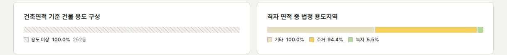

- **원인:** VWorld 용도지역 층에는 세부 용도지역(제2종일반주거 등) 위에 겹치는 상위 도형이 있습니다. 예: '도시지역' 43개, '도시지역기타' 38개, '도시지역미분류' 18개, '도시지역미지정' 9개, '관리지역' 5개. 이 상위 도형이 '기타'로 따로 더해집니다(`overlays.summarize_zoning`).
- **결과 1:** 군산 기본 대상지(cell_928500_1774500)는 기타 100%, 주거 94.4%, 녹지 5.5%로 합이 200%입니다.
- **결과 2:** 우세 용도지역(`dominant_zone`)이 '기타'로 잡힙니다. 그러면 지도 색, 지역 시뮬 '용도지역' 모드, 학습 자료의 구역 분류가 함께 틀립니다. 10/10 기록에 남긴 "부산 강서 용도지역 '기타' 대부분"도 같은 원인으로 보입니다.
- **고칠 방법:** 세부 용도지역이 있는 면적에서는 상위 도형을 빼고, 남은 면적만 '미세분'으로 셉니다.

**F2. 건물 용도가 모든 격자에서 '용도 미상 100%'**

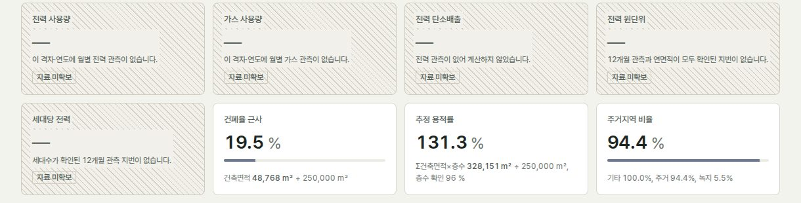

- **원인:** VWorld 도로명주소 건물 460,168동 모두 용도코드가 비어 있습니다(`use_code` null). 그래서 대시보드의 '건축면적 기준 건물 용도 구성'은 어느 격자에서도 빈 막대입니다.
- **고칠 방법:** 이미 받아 둔 건축물대장 표제부의 주용도로 셉니다(전주 73,147동, 군산 50,073동, 가평 32,058동). 그 전까지는 패널을 숨깁니다.

**F3. 지역 입력 캐시가 5분이라 대기가 반복됨**

- **원인:** `area.INPUTS_TTL = 300`초이고 캐시 칸은 3개입니다. 5분 넘게 안 쓰거나 다른 지역 3곳을 열면 처음부터 다시 읽습니다. 실측 대기는 47.8초(전주), 202초(완주)였고, nginx 대기 한도는 240초입니다.
- **고칠 방법:**
  - 자료가 바뀔 때만 캐시를 지웁니다(수집·지역 준비가 끝날 때 `forget`).
  - 준비된 지역은 서버를 켤 때 미리 데웁니다.
  - 기다리는 동안에는 "처음 계산 중, 약 1~2분" 같은 진행 안내를 보여 줍니다.

**F4. 사용 방법 화면이 옆으로 넘침**

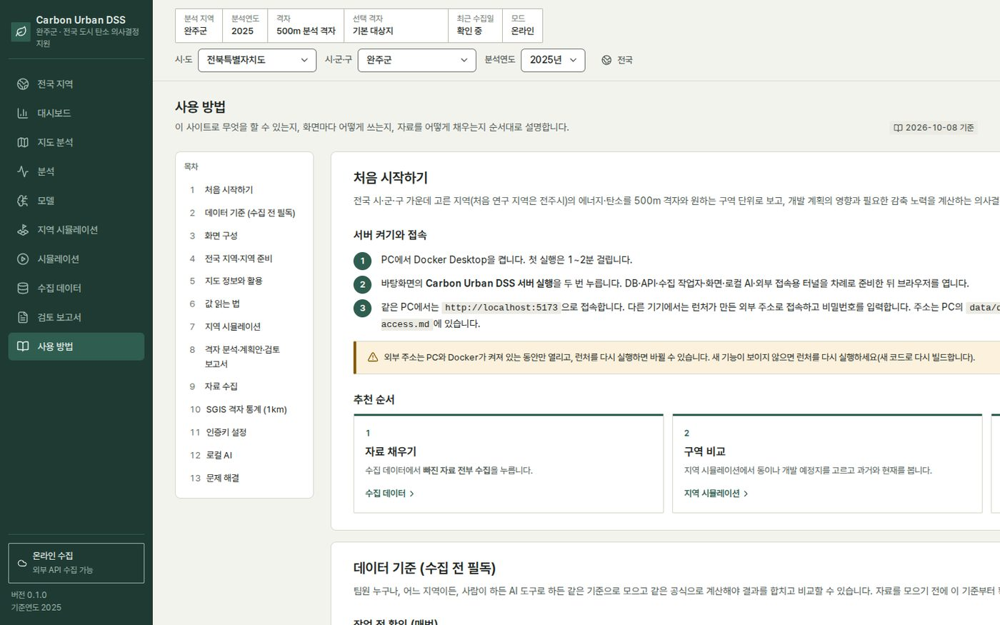 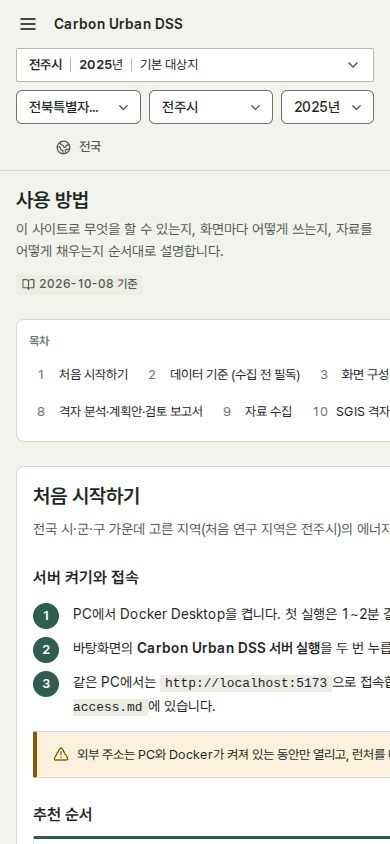

- **원인:** `.guide-body`(grid)의 자식이 `min-width: auto`이고, 줄바꿈하지 않는 코드 블록(`white-space: pre`)이 그 폭만큼 섹션을 늘립니다. 그래서 본문 폭이 1,907px이 됩니다.
- **고칠 방법:** `.guide-body > * { min-width: 0 }`을 넣고, 코드 블록은 자기 안에서만 가로 스크롤하게 합니다.

**F5. 결과 요약 막대가 머리 뒤에 숨음**

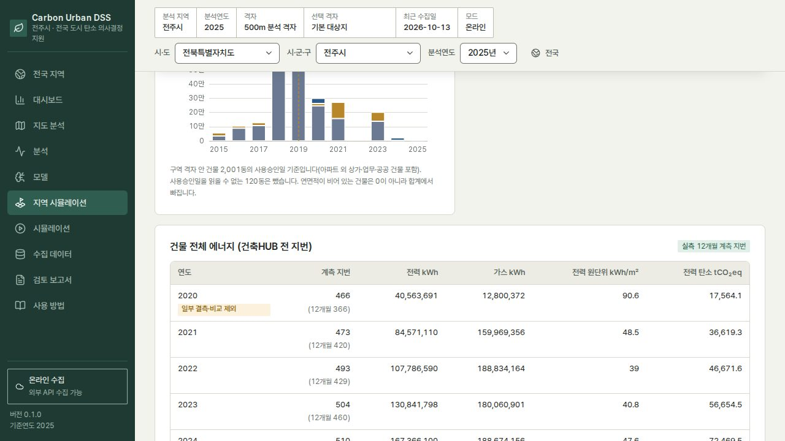

- **원인:** 머리(`.shell-header`, z 20)와 요약 막대(`.area-summary`, z 6)가 둘 다 `top: 0`에 붙습니다. 실측 위치는 머리 0~117px, 요약 막대 0~116px입니다.
- **결과:** 1101px 이상 화면에서는 스크롤하면 요약 막대가 보이지 않습니다. 10/10 촬영 때는 머리를 static으로 바꿔 찍어서 이 문제를 놓쳤습니다.
- **고칠 방법:** 요약 막대의 `top`을 머리 높이만큼 내립니다. 또는 스크롤하면 머리를 한 줄로 접고 그 아래에 요약 막대를 붙입니다.

**F6. 로딩 상태를 '미수집'이나 '없음'으로 안내**

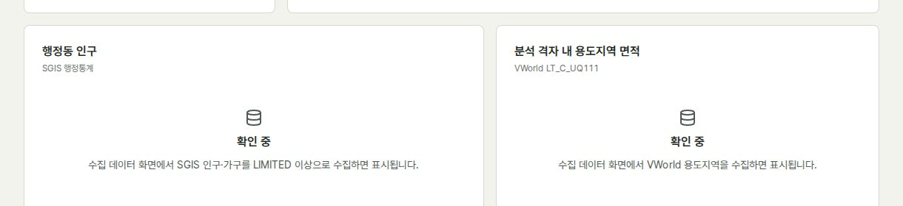

- **분석 화면:** 지도 오버레이 응답이 올 때까지(이번 측정에서 최대 40초) '확인 중' 아래에 "SGIS 인구·가구를 LIMITED 이상으로 수집하면 표시됩니다"를 함께 보여 줍니다. 이미 받은 자료인데 다시 받으라고 안내하는 셈입니다.
- **보고서 화면:** 범위(대시보드) 응답이 늦으면 저장된 계획안이 있어도 "이 범위에 저장된 계획안이 없습니다"라고 나옵니다. 완주 범위에서 시뮬레이션 계산 직후 재현했습니다.
- **지역 시뮬 빈 패널:** '계산 중입니다'와 "행정동을 고르거나 지도에서 위치를 누르면 계산합니다"가 한꺼번에 나옵니다.

### 중간: 헷갈리거나 잘못 읽힘

- **F7. 차트 범례의 색 표시가 없음**
  - 범례 아이콘이 14×2px 막대라 화면에서 보이지 않습니다(`chartTheme` legend `itemHeight: 2`).
  - 해당 차트: 대시보드 월별 에너지, 지역 시뮬 기상, 개발 전후.
  - 선 차트는 선 모양 아이콘(높이 3px 이상)이나 계열 끝 직접 표기로 바꿉니다.

  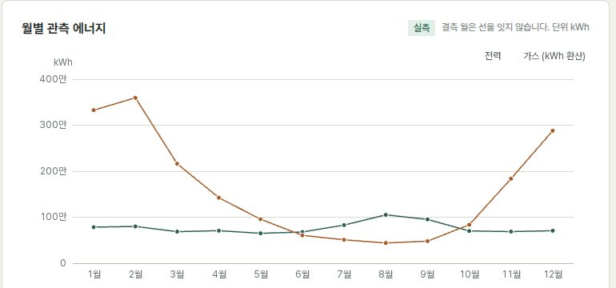
- **F8. 분석연도에 자료 없는 2026년이 있음**
  - 선택하면 에너지·탄소 지표가 모두 '자료 미확보'가 됩니다(아래 그림). 선택지는 자료가 있는 연도까지만 둡니다.
  - 같은 화면의 "건축HUB는 2024년부터 제공"이라는 문구도 틀렸습니다(전주는 2020년부터 있음).

  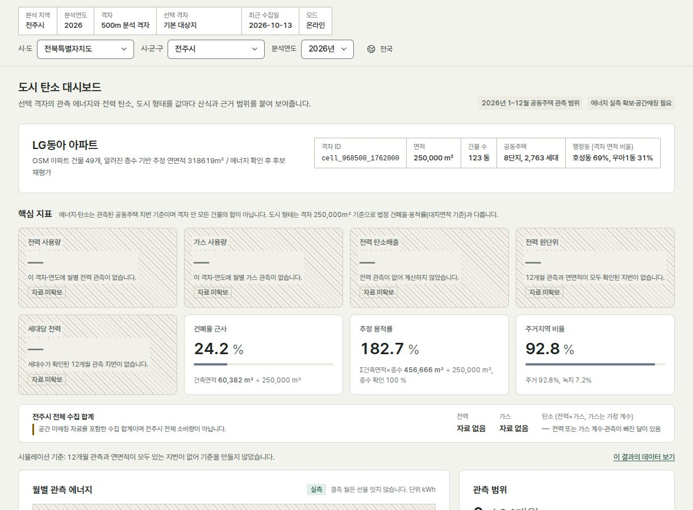
- **F9. 링크 하나가 전역 지역을 조용히 바꿈**
  - `/area?region=52710`을 열면 머리의 분석 지역이 완주군으로 바뀝니다.
  - 그 뒤 시뮬레이션·보고서·수집 화면도 모두 완주로 열립니다. 바뀔 때 알림을 띄웁니다.
- **F10. 수집 데이터 화면이 머리 지역을 무시함**
  - 머리는 완주군인데 화면은 "최초 연구 지역(전주시) 범위"입니다.
  - 지역별 과거 연도 진행(`energy_years`, `kapt_years`)을 이 화면에서 볼 수 없습니다.
- **F11. 앱 수집 작업 상태가 헷갈림**
  - '빠진 자료 전부 수집'에 10/9 15:40에 시작한 작업이 계속 '대기 중'으로 남아 있습니다.
  - 진행 막대는 100%로 차 있고, 버튼은 '수집 중'으로 잠겨 있습니다.

  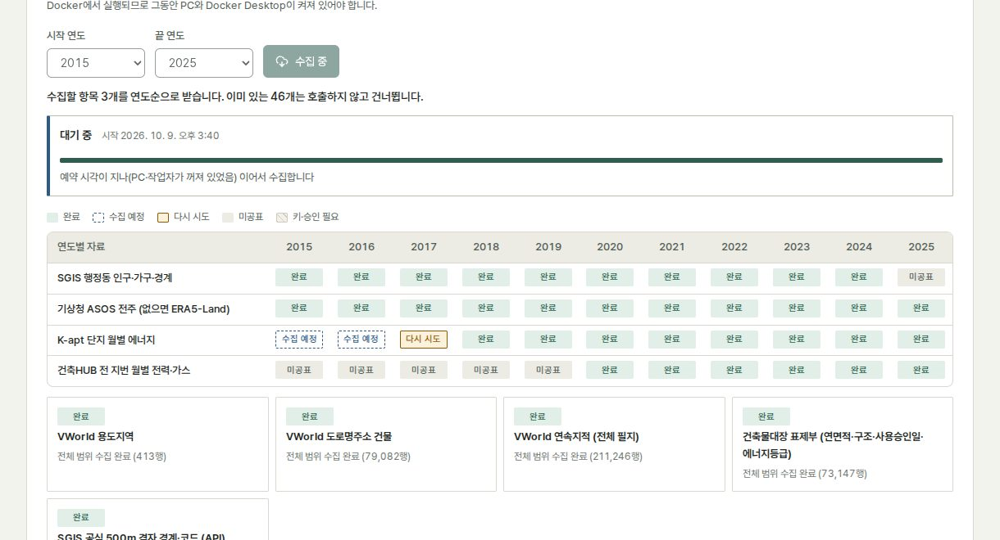
- **F12. 부분 수집 연도가 실제 사용량처럼 보임**
  - 지역 시뮬 '연도별 전력 사용량'의 2017년(관측 단지 1곳)과 2018년이 그냥 낮은 막대로 나옵니다.
  - 그래서 사용량이 늘어난 것처럼 읽힙니다. 개발 전후에는 주의 문구가 있지만 이 그래프에는 없으니 해치 표시를 넣습니다.
  - 개발 전후의 '+446.8 %'도 비교할 수 없다는 주의가 붙은 값인데 큰 굵은 글씨로 나오므로 흐리게 처리합니다.

  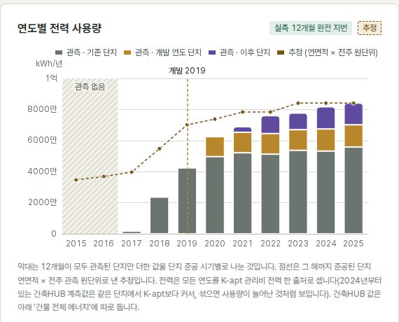
- **F13. 지도 화면이 늘 '전국'으로 열림**
  - 머리 범위가 전주시여도 그렇습니다. 시·군·구 보기를 기본으로 하거나 마지막 보기를 기억합니다.
  - 격자 위 말풍선이 범례 패널 뒤에 가려집니다(아래 그림 가운데).
  - 왼쪽 패널 셋이 지도 폭의 약 40%를 덮습니다.

  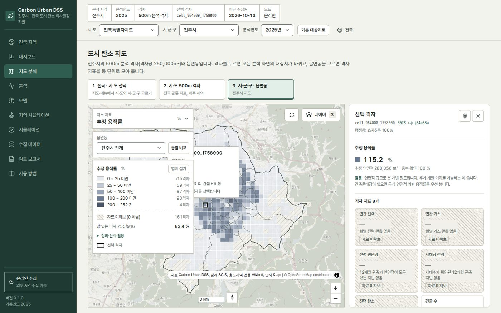
- **F14. 시뮬레이션 기본 입력이 법정 상한을 넘음**
  - 기본 입력의 용적률이 336%로 조례 상한 300%를 넘습니다. 그래서 첫 화면부터 빨간 경고가 뜹니다.
  - 기본값을 상한 안(예: 10층)으로 바꿉니다.

  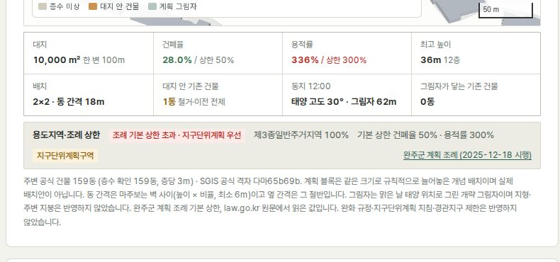

### 낮음: 다듬기

- **F15. 없는 주소:** `/does-not-exist`로 들어가면 대시보드가 그냥 나옵니다. 404 안내가 없습니다.
- **F16. 사실과 다른 문구**
  - "2025년 SGIS 인구를 아직 수집하지 않았습니다": 실제로는 제공기관이 아직 공표하지 않은 자료입니다.
  - "LIMITED 이상", "smoke 수집", COLLECTED·PARTIAL: 영문 상태값과 개발 용어가 화면에 그대로 나옵니다.
- **F17. 분석 화면 출처 표의 '기준 기간'**
  - 분석연도와 관계없이 마지막 수집 실행 기간이 보입니다. 예: ASOS 2015, K-apt "2017-01 · smoke 수집".
- **F18. 숫자 표기가 고르지 않음**
  - 쉼표 없음: '318619m²', '1656 / 120건'
  - 소수 자리 불일치: 원단위 '39'와 '48.5'
  - 보고서 감축 수단 표: 'kWh' 열에 kgCO2eq 합계가 섞여 있음
  - 정규화 행 수가 칸 안에서 줄바꿈됨('2,038,2 / 89')
- **F19. 터치에서 쓸 수 없는 안내**
  - "막대에 마우스를 올리면 단지명이 보입니다"는 모바일에서 볼 방법이 없습니다.

## 4. UI·GUI

- **고정 머리 높이**
  - 데스크톱 117px(900px 화면의 13%), 노트북 16%, 모바일 171px(844px의 20%)를 항상 차지합니다.
  - 스크롤하면 한 줄 요약(지역 · 연도 · 격자)으로 접고, 선택 상자는 누를 때 펼치면 작업 공간이 넓어집니다.
- **메뉴 10개의 이름이 겹침**
  - '지도 분석'과 '분석', '지역 시뮬레이션'과 '시뮬레이션'의 차이를 이름만으로는 알 수 없습니다.
  - 보고서도 두 곳입니다. 격자 보고서는 '검토 보고서' 메뉴에, 지역 보고서는 지역 시뮬 안에 있습니다.
  - 제안하는 묶음:
    - 탐색: 전국 지역, 지도, 대시보드, 관측 분석
    - 계획: 지역 시뮬레이션, 건물 배치 시뮬레이션
    - 결과: 보고서(지역·격자 함께)
    - 관리: 수집 데이터, 모델, 사용 방법
- **페이지 길이**
  - 지역 시뮬 9,118px(약 10화면), 수집 데이터 10,746px(모바일 25,285px, 약 30화면), 사용 방법 15,593px입니다.
  - 지역 시뮬은 단계 칩(1~5)으로 이동할 수 있지만, 수집 데이터와 대시보드에는 쪽 안 이동 수단이 없습니다.
  - 근거·산식 문장을 접어 두는 방식(펼치면 보이기)을 권합니다.
- **모바일**
  - 지도 화면에서는 설명·단계·시·도 칩 아래로 지도가 밀려 첫 화면에 지도가 보이지 않습니다(아래 그림).
  - 시뮬레이션의 3D도 아래쪽에 있습니다.

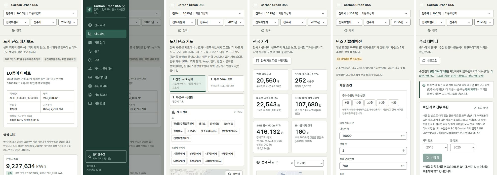

- **접근성(axe, WCAG 2.1 AA)**
  - 수집 데이터 화면
    - 파일 입력과 업로드 종류 선택에 라벨이 없습니다(critical 2).
    - 진행률 `div`에 쓸 수 없는 `aria-label`이 붙어 있습니다.
    - 표와 작업 목록 스크롤 영역을 키보드로 움직일 수 없습니다.
  - 대비 부족
    - 지역 시뮬 지도의 MapLibre 저작권 링크: 2.02:1
    - 추정 카드 작은 글씨 `#6b746e`/`#f4ebda`: 4.08:1
    - 지도 단계 링크 작은 글씨: 4.05:1
    - `.muted`/`--surface-sunk`: 4.04:1
    - DESIGN.md 8절은 "`--ink-3`은 흰 바탕에서만"이라고 정했는데, 이 기준을 어긴 곳이 3군데입니다.
  - 12px 미만 글자: 대시보드 24개, 수집 데이터 50개, 지도 19개(10~11.9px). 디자인 기준 최소 크기는 12px입니다.
  - 로딩·오류 상태에 `role="status"`·`role="alert"`가 없습니다(코드 확인).
  - 본문으로 건너뛰는 링크가 없습니다.

## 5. 디자인

**강점**

- 'D안 도시계획 도면' 디자인 체계가 화면 전체에 일관되게 적용되어 있습니다. 토큰 밖 hex는 1곳뿐입니다.
- 실측·계산·추정 배지와 결측 해치가 '없는 값은 0이 아님'을 시각적으로 지킵니다.
- 표제란(분석 지역·연도·격자·선택 격자·수집일·모드)이 어디서나 범위를 보여 줍니다.
- 인쇄 보고서가 깔끔합니다.

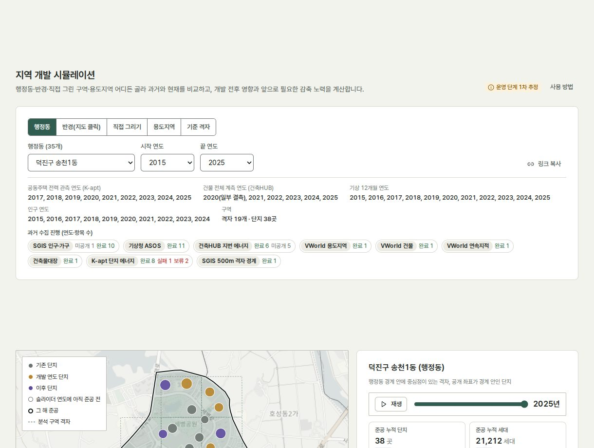 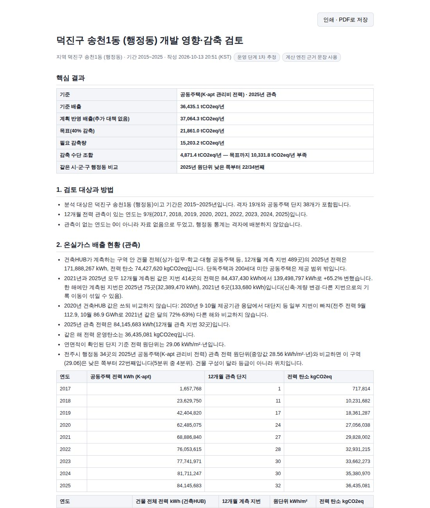

**고칠 점**

- 반응형 경계값이 9가지로 흩어져 있습니다: 470, 560, 640, 720, 760, 1023, 1100, 1180, 1280px. 3~4개(560 / 760 / 1024 / 1280)로 줄입니다.
- 2열 패널의 높이가 달라 빈 공간이 크게 남습니다. 예: 지역 시뮬 기상 패널 아래, 전국 지역 오른쪽 패널.
- 주의가 붙은 값(비교 불가)도 일반 값과 같은 큰 굵은 숫자로 나옵니다. 주의 상태를 회색이나 해치로 구분합니다.
- 한 화면 안에서 회색 작은 설명문이 많습니다(대시보드 카드마다 산식 문장). 핵심 수치와 근거 문장의 위계를 더 벌리면 읽는 속도가 빨라집니다.
- 지도 위 패널(지표, 읍면동, 범례)이 겹쳐 있습니다. 범례 접기는 있지만 패널을 하나로 묶거나 지도 밖으로 빼는 편이 낫습니다.

## 6. 고치는 순서 (제안)

1. 용도지역 겹침(F1)과 건물 용도(F2): 값이 틀린 것부터 고칩니다. 고친 뒤 영향을 받는 사례와 학습 자료를 다시 확인합니다.
2. 지역 입력 캐시(F3): 자료가 바뀔 때만 지우고, 서버를 켤 때 데우고, 진행 안내를 붙입니다.
3. 사용 방법 넘침(F4), 요약 막대(F5), 범례(F7): CSS만 고치면 됩니다.
4. 로딩과 미수집 구분(F6), 연도 선택지(F8), 지역 전환 알림(F9), 404(F15)
5. 접근성: 라벨, 대비, 12px, role
6. 메뉴 이름·묶음과 고정 머리 접기: 사용자 확인 뒤 진행합니다.

## 7. 검토하지 않은 것

- 실제 사용자(업체·지자체 담당자)를 대상으로 한 과업 시험은 하지 않았습니다. 이번 검토는 자동 촬영과 지표, 코드 확인입니다.
- 화면 읽기 프로그램(NVDA 등)으로 직접 들어 보지 않았습니다. axe 자동 검사로 대신했습니다.
- 외부 주소(공개 링크)로 접속한 속도는 재지 않았습니다. 같은 PC 안 Docker 네트워크에서 잰 값입니다.
- 로컬 AI 요약을 켠 보고서 작성 시간은 이번에 재지 않았습니다(10/10 점검에서 요약 38~56초).
